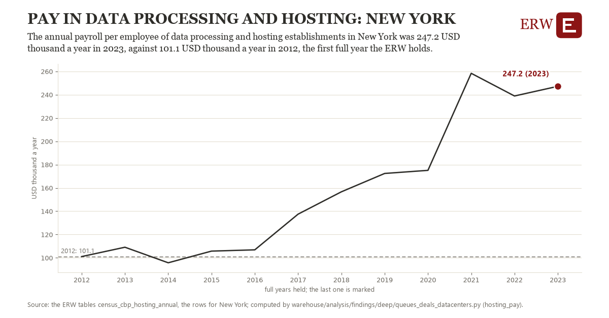

# Pay in data processing and hosting: New York

Draft `scan-deep-5617da2c6d05` of the findings hunt over the whole warehouse (chain 164), 2026-11-06. State: draft, not reviewed. Review at `/internal/findings`.

**The finding.** The annual payroll per employee of data processing and hosting establishments in New York was 247.2 USD thousand a year in 2023, against 101.1 USD thousand a year in 2012, the first full year the ERW holds.

**The figure by full year** (USD thousand a year): 2012: 101.1, 2013: 109.1, 2014: 95.8, 2015: 105.8, 2016: 106.9, 2017: 137.5, 2018: 156.7, 2019: 172.4, 2020: 175.1, 2021: 258.4, 2022: 238.9, 2023: 247.2.

**The tables and rows.** `census_cbp_hosting_annual`; the rows for New York, region key `pay518_NY` (the card's `hunt.region`), years 2012 to 2023. The yearly values: `hosting-pay-pay518-ny.csv`.

**Its strength.** The change is 7.38 typical yearly moves (a typical move is 19.8 USD thousand a year, 1.4826 times the median absolute change between full years). Holds in more than one year: 10 of the 11 full years after 2012 lie above 2012's value. Survives a change of window: from 2013 to 2023 the change is 138.1, from 2012 to 2022 it is 137.8. Sample large enough: 2012 holds 1 and 2023 holds 1 observations; the floor is 1. Half the change remains without the first year: from 2013 to 2023 the change is 138.1, 94.5 percent of the change from 2012. At least one typical yearly move: the change is 7.38 typical yearly moves (19.8 USD thousand a year a year, the median move between full years); the floor is 1.

**Its limits.** County Business Patterns counts establishments by their main activity, so a data center run inside another firm's establishment is not in it; the Census Bureau adds noise to protect respondents, and NAICS 518210's definition widened with the 2022 codes. Nominal dollars.

**Reproduce.** `python hosting-pay-pay518-ny.reproduce.py <the table's CSV>` and `do hosting-pay-pay518-ny.reproduce.do` (Stata) recompute the figures by year from the tables as the public downloads hold them; each names the expected values at its top.
