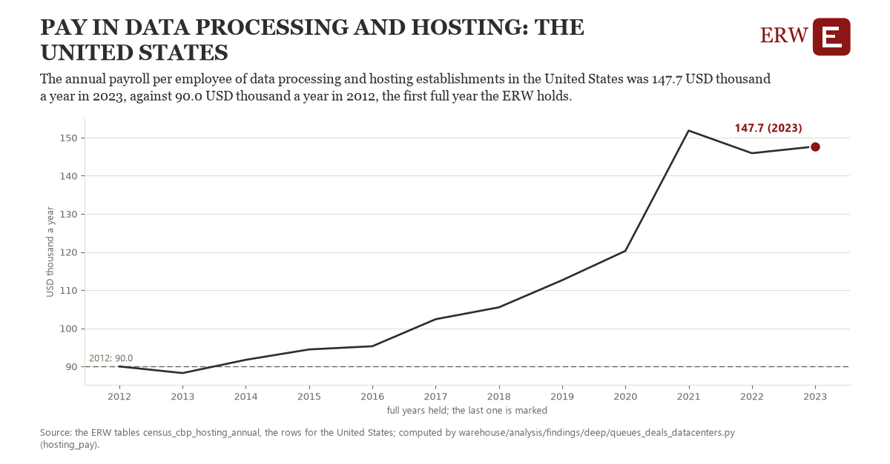

# Pay in data processing and hosting: the United States

Draft `scan-deep-1f413dfcbd8e` of the findings hunt over the whole warehouse (chain 164), 2026-11-06. State: draft, not reviewed. Review at `/internal/findings`.

**The finding.** The annual payroll per employee of data processing and hosting establishments in the United States was 147.7 USD thousand a year in 2023, against 90.0 USD thousand a year in 2012, the first full year the ERW holds.

**The figure by full year** (USD thousand a year): 2012: 90.0, 2013: 88.2, 2014: 91.7, 2015: 94.4, 2016: 95.3, 2017: 102.4, 2018: 105.5, 2019: 112.6, 2020: 120.3, 2021: 151.8, 2022: 145.9, 2023: 147.7.

**The tables and rows.** `census_cbp_hosting_annual`; the rows for the United States, region key `pay518_US` (the card's `hunt.region`), years 2012 to 2023. The yearly values: `hosting-pay-pay518-us.csv`.

**Its strength.** The change is 11.19 typical yearly moves (a typical move is 5.2 USD thousand a year, 1.4826 times the median absolute change between full years). Holds in more than one year: 10 of the 11 full years after 2012 lie above 2012's value. Survives a change of window: from 2013 to 2023 the change is 59.4, from 2012 to 2022 it is 55.9. Sample large enough: 2012 holds 1 and 2023 holds 1 observations; the floor is 1. Half the change remains without the first year: from 2013 to 2023 the change is 59.4, 103.0 percent of the change from 2012. At least one typical yearly move: the change is 11.19 typical yearly moves (5.2 USD thousand a year a year, the median move between full years); the floor is 1.

**Its limits.** County Business Patterns counts establishments by their main activity, so a data center run inside another firm's establishment is not in it; the Census Bureau adds noise to protect respondents, and NAICS 518210's definition widened with the 2022 codes. Nominal dollars.

**Reproduce.** `python hosting-pay-pay518-us.reproduce.py <the table's CSV>` and `do hosting-pay-pay518-us.reproduce.do` (Stata) recompute the figures by year from the tables as the public downloads hold them; each names the expected values at its top.
