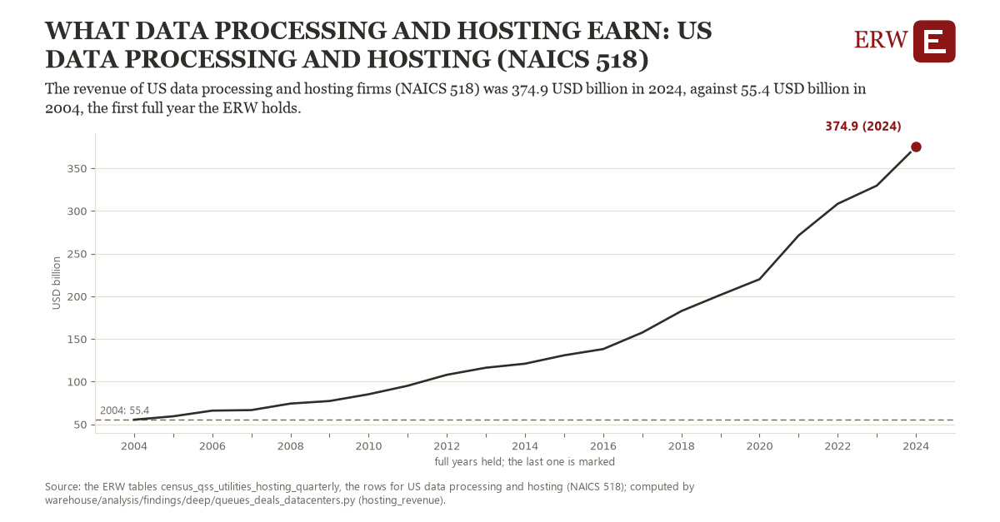

# What data processing and hosting earn: US data processing and hosting (NAICS 518)

Draft `scan-deep-14b8c3d3809e` of the findings hunt over the whole warehouse (chain 164), 2026-11-06. State: draft, not reviewed. Review at `/internal/findings`.

**The finding.** The revenue of US data processing and hosting firms (NAICS 518) was 374.9 USD billion in 2024, against 55.4 USD billion in 2004, the first full year the ERW holds.

**The figure by full year** (USD billion): 2004: 55.4, 2005: 59.4, 2006: 66.0, 2007: 66.7, 2008: 74.3, 2009: 77.3, 2010: 85.2, 2011: 95.2, 2012: 108.0, 2013: 116.3, 2014: 121.0, 2015: 130.8, 2016: 138.1, 2017: 157.5, 2018: 182.7, 2019: 201.6, 2020: 219.9, 2021: 271.2, 2022: 308.3, 2023: 329.6, 2024: 374.9.

**The tables and rows.** `census_qss_utilities_hosting_quarterly`; the rows for US data processing and hosting (NAICS 518), region key `us_rev518` (the card's `hunt.region`), years 2004 to 2024. The yearly values: `hosting-revenue-us-rev518.csv`.

**Its strength.** The change is 21.77 typical yearly moves (a typical move is 14.7 USD billion, 1.4826 times the median absolute change between full years). Holds in more than one year: 20 of the 20 full years after 2004 lie above 2004's value. Survives a change of window: from 2005 to 2024 the change is 315.6, from 2004 to 2023 it is 274.2. Sample large enough: 2004 holds 4 and 2024 holds 4 observations; the floor is 4. Half the change remains without the first year: from 2005 to 2024 the change is 315.6, 98.8 percent of the change from 2004. At least one typical yearly move: the change is 21.77 typical yearly moves (14.7 USD billion a year, the median move between full years); the floor is 1.

**Its limits.** The Quarterly Services Survey's estimate, nominal dollars, not seasonally adjusted; NAICS 518 covers far more than data centers.

**Reproduce.** `python hosting-revenue-us-rev518.reproduce.py <the table's CSV>` and `do hosting-revenue-us-rev518.reproduce.do` (Stata) recompute the figures by year from the tables as the public downloads hold them; each names the expected values at its top.
