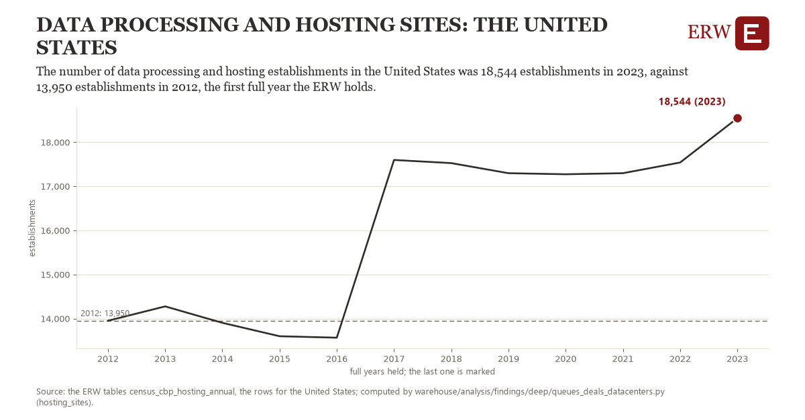

# Data processing and hosting sites: the United States

Draft `scan-deep-64e34aef7b05` of the findings hunt over the whole warehouse (chain 164), 2026-11-06. State: draft, not reviewed. Review at `/internal/findings`.

**The finding.** The number of data processing and hosting establishments in the United States was 18,544 establishments in 2023, against 13,950 establishments in 2012, the first full year the ERW holds.

**The figure by full year** (establishments): 2012: 13,950, 2013: 14,276, 2014: 13,903, 2015: 13,599, 2016: 13,566, 2017: 17,597, 2018: 17,526, 2019: 17,297, 2020: 17,273, 2021: 17,297, 2022: 17,539, 2023: 18,544.

**The tables and rows.** `census_cbp_hosting_annual`; the rows for the United States, region key `est518_US` (the card's `hunt.region`), years 2012 to 2023. The yearly values: `hosting-sites-est518-us.csv`.

**Its strength.** The change is 12.80 typical yearly moves (a typical move is 359 establishments, 1.4826 times the median absolute change between full years). Holds in more than one year: 8 of the 11 full years after 2012 lie above 2012's value. Survives a change of window: from 2013 to 2023 the change is 4,268, from 2012 to 2022 it is 3,589. Sample large enough: 2012 holds 1 and 2023 holds 1 observations; the floor is 1. Half the change remains without the first year: from 2013 to 2023 the change is 4,268, 92.9 percent of the change from 2012. At least one typical yearly move: the change is 12.80 typical yearly moves (359 establishments a year, the median move between full years); the floor is 1.

**Its limits.** County Business Patterns counts establishments by their main activity, so a data center run inside another firm's establishment is not in it; the Census Bureau adds noise to protect respondents, and NAICS 518210's definition widened with the 2022 codes.

**Reproduce.** `python hosting-sites-est518-us.reproduce.py <the table's CSV>` and `do hosting-sites-est518-us.reproduce.do` (Stata) recompute the figures by year from the tables as the public downloads hold them; each names the expected values at its top.
