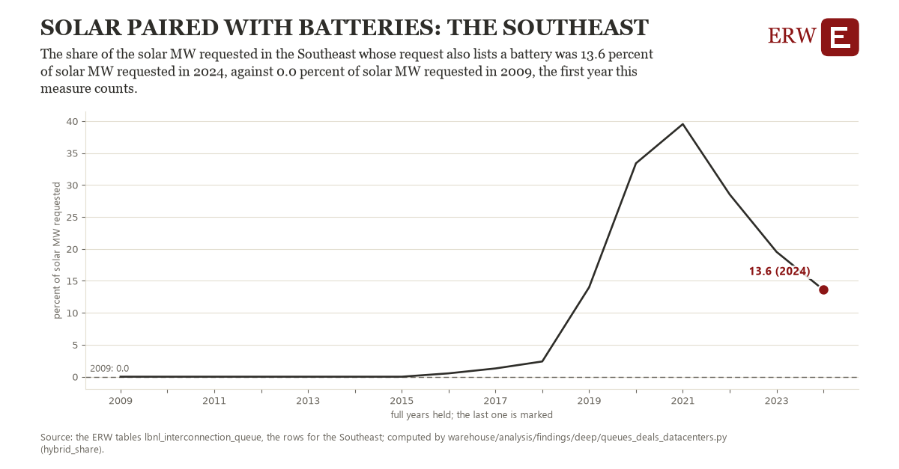

# Solar paired with batteries: the Southeast

Draft `scan-deep-60e6cbd9b000` of the findings hunt over the whole warehouse (chain 164), 2026-11-06. State: draft, not reviewed. Review at `/internal/findings`.

**The finding.** The share of the solar MW requested in the Southeast whose request also lists a battery was 13.6 percent of solar MW requested in 2024, against 0.0 percent of solar MW requested in 2009, the first year this measure counts.

**The figure by full year** (percent of solar MW requested): 2009: 0.0, 2010: 0.0, 2011: 0.0, 2012: 0.0, 2013: 0.0, 2014: 0.0, 2015: 0.0, 2016: 0.5, 2017: 1.3, 2018: 2.4, 2019: 14.0, 2020: 33.4, 2021: 39.5, 2022: 28.5, 2023: 19.5, 2024: 13.6.

**The tables and rows.** `lbnl_interconnection_queue`; the rows for the Southeast, region key `southeast_lbnl_hybrid` (the card's `hunt.region`), years 2009 to 2024. The yearly values: `hybrid-share-southeast-lbnl-hybrid.csv`.

**Its strength.** The change is 11.93 typical yearly moves (a typical move is 1.1 percent of solar MW requested, 1.4826 times the median absolute change between full years). Holds in more than one year: 9 of the 15 full years after 2009 lie above 2009's value. Survives a change of window: from 2010 to 2024 the change is 13.6, from 2009 to 2023 it is 19.5. Sample large enough: 2009 holds 1 and 2024 holds 1 observations; the floor is 1. Half the change remains without the first year: from 2010 to 2024 the change is 13.6, 100.0 percent of the change from 2009. At least one typical yearly move: the change is 11.93 typical yearly moves (1.1 percent of solar MW requested a year, the median move between full years); the floor is 1.

**Its limits.** Berkeley Lab's Queued Up as the ERW holds it (CC BY 4.0, Lawrence Berkeley National Laboratory and GridTracker); a request's dates are those its transmission provider published, and some providers list no withdrawal date. A request counts as paired when Berkeley Lab lists a battery as its second or third type; its MW is the solar part.

**Reproduce.** `python hybrid-share-southeast-lbnl-hybrid.reproduce.py <the table's CSV>` and `do hybrid-share-southeast-lbnl-hybrid.reproduce.do` (Stata) recompute the figures by year from the tables as the public downloads hold them; each names the expected values at its top.
