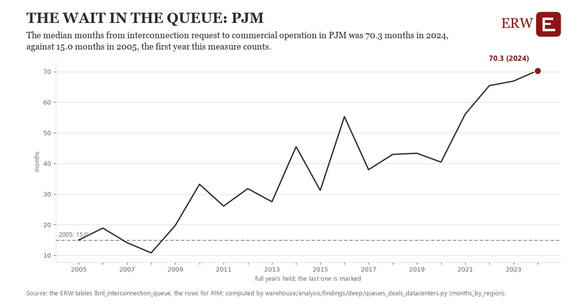

# The wait in the queue: PJM

Draft `scan-deep-b087f09de0f6` of the findings hunt over the whole warehouse (chain 164), 2026-11-06. State: draft, not reviewed. Review at `/internal/findings`.

**The finding.** The median months from interconnection request to commercial operation in PJM was 70.3 months in 2024, against 15.0 months in 2005, the first year this measure counts.

**The figure by full year** (months): 2005: 15.0, 2006: 18.9, 2007: 14.1, 2008: 10.8, 2009: 19.7, 2010: 33.2, 2011: 26.1, 2012: 31.8, 2013: 27.5, 2014: 45.5, 2015: 31.2, 2016: 55.3, 2017: 37.9, 2018: 42.9, 2019: 43.3, 2020: 40.4, 2021: 56.1, 2022: 65.4, 2023: 66.9, 2024: 70.3.

**The tables and rows.** `lbnl_interconnection_queue`; the rows for PJM, region key `pjm_lbnl_months` (the card's `hunt.region`), years 2005 to 2024. The yearly values: `months-by-region-pjm-lbnl-months.csv`.

**Its strength.** The change is 6.55 typical yearly moves (a typical move is 8.5 months, 1.4826 times the median absolute change between full years). Holds in more than one year: 17 of the 19 full years after 2005 lie above 2005's value. Survives a change of window: from 2006 to 2024 the change is 51.5, from 2005 to 2023 it is 51.9. Sample large enough: 2005 holds 1 and 2024 holds 1 observations; the floor is 1. Half the change remains without the first year: from 2006 to 2024 the change is 51.5, 93.0 percent of the change from 2005. At least one typical yearly move: the change is 6.55 typical yearly moves (8.5 months a year, the median move between full years); the floor is 1.

**Its limits.** Berkeley Lab's Queued Up as the ERW holds it (CC BY 4.0, Lawrence Berkeley National Laboratory and GridTracker); a request's dates are those its transmission provider published, and some providers list no withdrawal date. Only projects that came online are in the median, and a year needs at least ten of them.

**Reproduce.** `python months-by-region-pjm-lbnl-months.reproduce.py <the table's CSV>` and `do months-by-region-pjm-lbnl-months.reproduce.do` (Stata) recompute the figures by year from the tables as the public downloads hold them; each names the expected values at its top.
