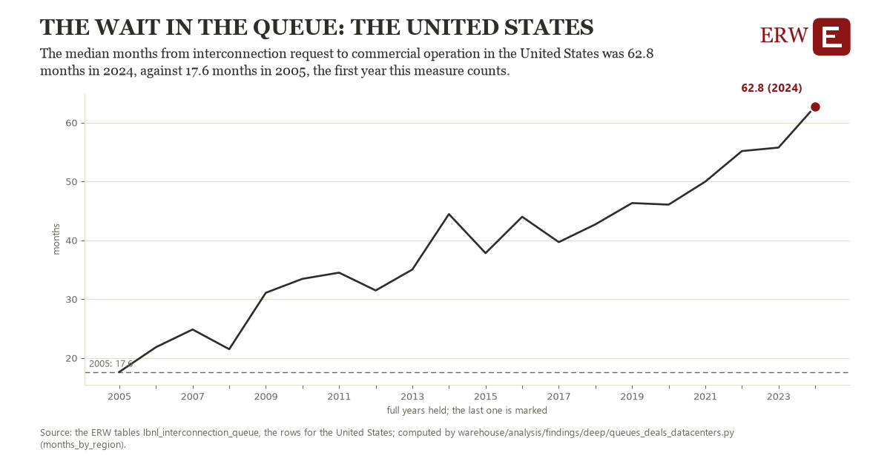

# The wait in the queue: the United States

Draft `scan-deep-3a40649cbec1` of the findings hunt over the whole warehouse (chain 164), 2026-11-06. State: draft, not reviewed. Review at `/internal/findings`.

**The finding.** The median months from interconnection request to commercial operation in the United States was 62.8 months in 2024, against 17.6 months in 2005, the first year this measure counts.

**The figure by full year** (months): 2005: 17.6, 2006: 21.8, 2007: 24.8, 2008: 21.5, 2009: 31.1, 2010: 33.4, 2011: 34.5, 2012: 31.5, 2013: 35.0, 2014: 44.5, 2015: 37.8, 2016: 44.0, 2017: 39.7, 2018: 42.7, 2019: 46.3, 2020: 46.1, 2021: 50.0, 2022: 55.2, 2023: 55.8, 2024: 62.8.

**The tables and rows.** `lbnl_interconnection_queue`; the rows for the United States, region key `us_lbnl_months` (the card's `hunt.region`), years 2005 to 2024. The yearly values: `months-by-region-us-lbnl-months.csv`.

**Its strength.** The change is 8.42 typical yearly moves (a typical move is 5.4 months, 1.4826 times the median absolute change between full years). Holds in more than one year: 19 of the 19 full years after 2005 lie above 2005's value. Survives a change of window: from 2006 to 2024 the change is 40.9, from 2005 to 2023 it is 38.1. Sample large enough: 2005 holds 1 and 2024 holds 1 observations; the floor is 1. Half the change remains without the first year: from 2006 to 2024 the change is 40.9, 90.7 percent of the change from 2005. At least one typical yearly move: the change is 8.42 typical yearly moves (5.4 months a year, the median move between full years); the floor is 1.

**Its limits.** Berkeley Lab's Queued Up as the ERW holds it (CC BY 4.0, Lawrence Berkeley National Laboratory and GridTracker); a request's dates are those its transmission provider published, and some providers list no withdrawal date. Only projects that came online are in the median, and a year needs at least ten of them.

**Reproduce.** `python months-by-region-us-lbnl-months.reproduce.py <the table's CSV>` and `do months-by-region-us-lbnl-months.reproduce.do` (Stata) recompute the figures by year from the tables as the public downloads hold them; each names the expected values at its top.
