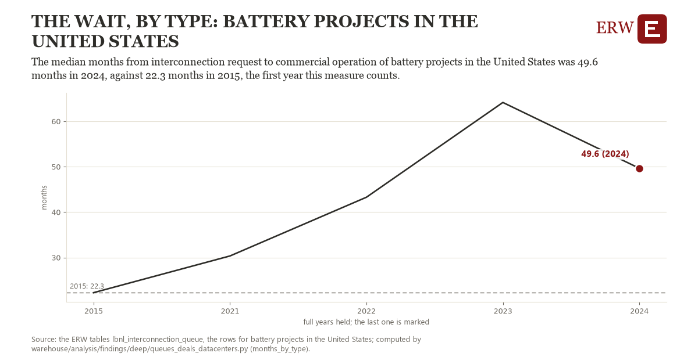

# The wait, by type: battery projects in the United States

Draft `scan-deep-5cae45311577` of the findings hunt over the whole warehouse (chain 164), 2026-11-06. State: draft, not reviewed. Review at `/internal/findings`.

**The finding.** The median months from interconnection request to commercial operation of battery projects in the United States was 49.6 months in 2024, against 22.3 months in 2015, the first year this measure counts.

**The figure by full year** (months): 2015: 22.3, 2021: 30.3, 2022: 43.3, 2023: 64.1, 2024: 49.6.

**The tables and rows.** `lbnl_interconnection_queue`; the rows for battery projects in the United States, region key `us_type_battery_months` (the card's `hunt.region`), years 2015 to 2024. The yearly values: `months-by-type-us-type-battery-months.csv`.

**Its strength.** The change is 1.35 typical yearly moves (a typical move is 20.3 months, 1.4826 times the median absolute change between full years). Holds in more than one year: 4 of the 4 full years after 2015 lie above 2015's value. Survives a change of window: from 2021 to 2024 the change is 19.3, from 2015 to 2023 it is 41.9. Sample large enough: 2015 holds 1 and 2024 holds 1 observations; the floor is 1. Half the change remains without the first year: from 2021 to 2024 the change is 19.3, 70.5 percent of the change from 2015. At least one typical yearly move: the change is 1.35 typical yearly moves (20.3 months a year, the median move between full years); the floor is 1.

**Its limits.** Berkeley Lab's Queued Up as the ERW holds it (CC BY 4.0, Lawrence Berkeley National Laboratory and GridTracker); a request's dates are those its transmission provider published, and some providers list no withdrawal date. Only projects that came online are in the median, a year needs at least ten of them, and a hybrid counts as its first type.

**Reproduce.** `python months-by-type-us-type-battery-months.reproduce.py <the table's CSV>` and `do months-by-type-us-type-battery-months.reproduce.do` (Stata) recompute the figures by year from the tables as the public downloads hold them; each names the expected values at its top.
