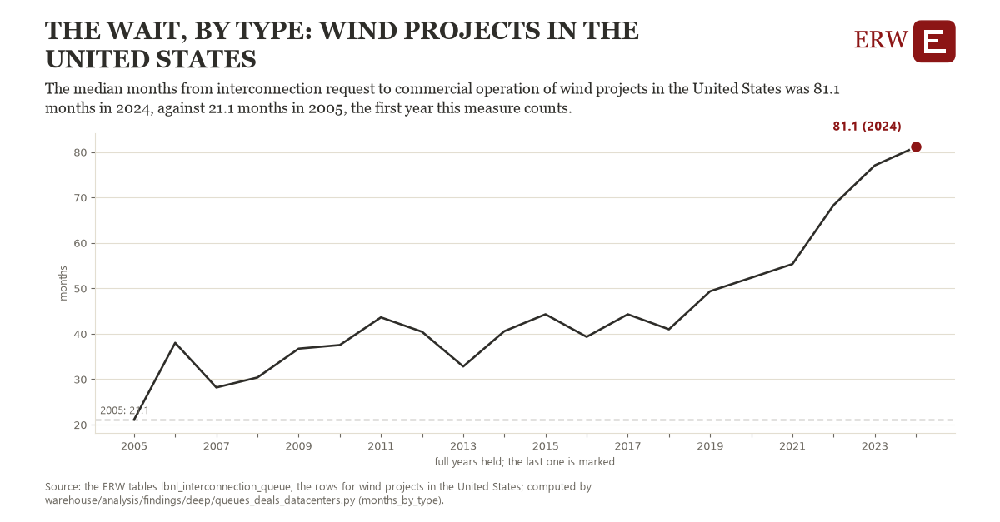

# The wait, by type: wind projects in the United States

Draft `scan-deep-462f0003f4c4` of the findings hunt over the whole warehouse (chain 164), 2026-11-06. State: draft, not reviewed. Review at `/internal/findings`.

**The finding.** The median months from interconnection request to commercial operation of wind projects in the United States was 81.1 months in 2024, against 21.1 months in 2005, the first year this measure counts.

**The figure by full year** (months): 2005: 21.1, 2006: 38.0, 2007: 28.2, 2008: 30.4, 2009: 36.7, 2010: 37.5, 2011: 43.6, 2012: 40.4, 2013: 32.8, 2014: 40.6, 2015: 44.3, 2016: 39.3, 2017: 44.3, 2018: 41.0, 2019: 49.4, 2020: 52.3, 2021: 55.3, 2022: 68.3, 2023: 77.0, 2024: 81.1.

**The tables and rows.** `lbnl_interconnection_queue`; the rows for wind projects in the United States, region key `us_type_wind_months` (the card's `hunt.region`), years 2005 to 2024. The yearly values: `months-by-type-us-type-wind-months.csv`.

**Its strength.** The change is 8.16 typical yearly moves (a typical move is 7.4 months, 1.4826 times the median absolute change between full years). Holds in more than one year: 19 of the 19 full years after 2005 lie above 2005's value. Survives a change of window: from 2006 to 2024 the change is 43.1, from 2005 to 2023 it is 56.0. Sample large enough: 2005 holds 1 and 2024 holds 1 observations; the floor is 1. Half the change remains without the first year: from 2006 to 2024 the change is 43.1, 71.8 percent of the change from 2005. At least one typical yearly move: the change is 8.16 typical yearly moves (7.4 months a year, the median move between full years); the floor is 1.

**Its limits.** Berkeley Lab's Queued Up as the ERW holds it (CC BY 4.0, Lawrence Berkeley National Laboratory and GridTracker); a request's dates are those its transmission provider published, and some providers list no withdrawal date. Only projects that came online are in the median, a year needs at least ten of them, and a hybrid counts as its first type.

**Reproduce.** `python months-by-type-us-type-wind-months.reproduce.py <the table's CSV>` and `do months-by-type-us-type-wind-months.reproduce.do` (Stata) recompute the figures by year from the tables as the public downloads hold them; each names the expected values at its top.
