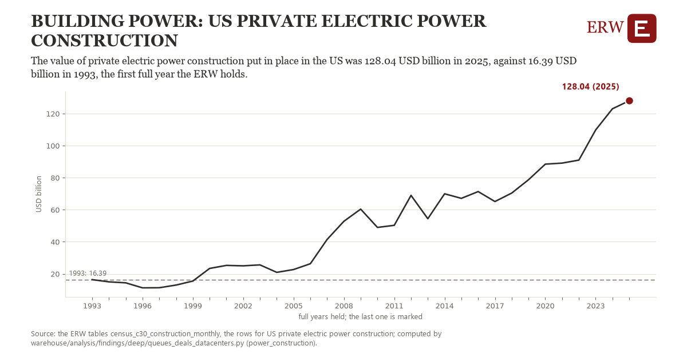

# Building power: US private electric power construction

Draft `scan-deep-ee79f812b00a` of the findings hunt over the whole warehouse (chain 164), 2026-11-06. State: draft, not reviewed. Review at `/internal/findings`.

**The finding.** The value of private electric power construction put in place in the US was 128.04 USD billion in 2025, against 16.39 USD billion in 1993, the first full year the ERW holds.

**The figure by full year** (USD billion): 1993: 16.39, 1994: 14.99, 1995: 14.40, 1996: 11.26, 1997: 11.32, 1998: 12.99, 1999: 15.49, 2000: 23.38, 2001: 25.27, 2002: 25.00, 2003: 25.59, 2004: 20.93, 2005: 22.68, 2006: 26.30, 2007: 41.46, 2008: 52.80, 2009: 60.40, 2010: 48.97, 2011: 50.29, 2012: 68.97, 2013: 54.41, 2014: 69.97, 2015: 67.12, 2016: 71.36, 2017: 65.14, 2018: 70.42, 2019: 78.74, 2020: 88.48, 2021: 89.13, 2022: 91.00, 2023: 109.82, 2024: 123.04, 2025: 128.04.

**The tables and rows.** `census_c30_construction_monthly`; the rows for US private electric power construction, region key `us_power_build` (the card's `hunt.region`), years 1993 to 2025. The yearly values: `power-construction-us-power-build.csv`.

**Its strength.** The change is 16.93 typical yearly moves (a typical move is 6.60 USD billion, 1.4826 times the median absolute change between full years). Holds in more than one year: 26 of the 32 full years after 1993 lie above 1993's value. Survives a change of window: from 1994 to 2025 the change is 113.05, from 1993 to 2024 it is 106.66. Sample large enough: 1993 holds 12 and 2025 holds 12 observations; the floor is 11. Half the change remains without the first year: from 1994 to 2025 the change is 113.05, 101.3 percent of the change from 1993. At least one typical yearly move: the change is 16.93 typical yearly moves (6.60 USD billion a year, the median move between full years); the floor is 1.

**Its limits.** The Census Bureau's value put in place, nominal dollars, not seasonally adjusted; the latest months are preliminary and are revised. Electric power construction counts generation, transmission and distribution projects together.

**Reproduce.** `python power-construction-us-power-build.reproduce.py <the table's CSV>` and `do power-construction-us-power-build.reproduce.do` (Stata) recompute the figures by year from the tables as the public downloads hold them; each names the expected values at its top.
