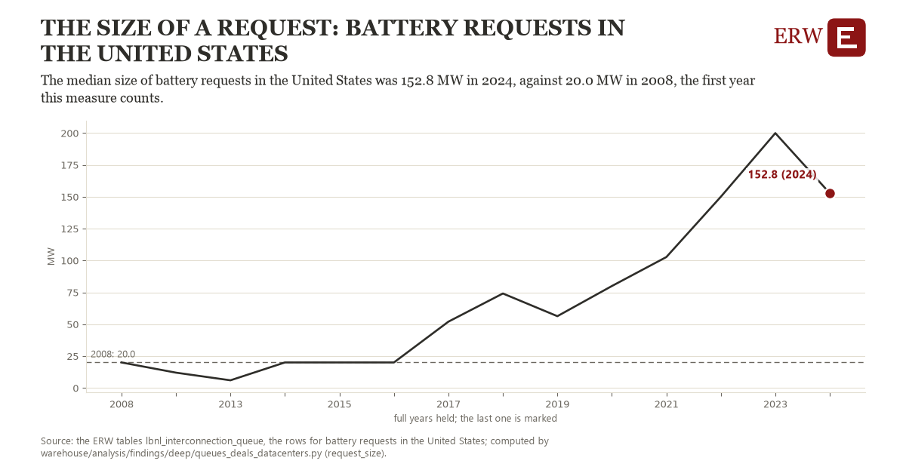

# The size of a request: battery requests in the United States

Draft `scan-deep-6ca546fc88a0` of the findings hunt over the whole warehouse (chain 164), 2026-11-06. State: draft, not reviewed. Review at `/internal/findings`.

**The finding.** The median size of battery requests in the United States was 152.8 MW in 2024, against 20.0 MW in 2008, the first year this measure counts.

**The figure by full year** (MW): 2008: 20.0, 2012: 12.0, 2013: 6.0, 2014: 20.0, 2015: 20.0, 2016: 20.0, 2017: 52.0, 2018: 74.1, 2019: 56.3, 2020: 80.0, 2021: 102.7, 2022: 150.0, 2023: 199.9, 2024: 152.8.

**The tables and rows.** `lbnl_interconnection_queue`; the rows for battery requests in the United States, region key `us_type_battery_size` (the card's `hunt.region`), years 2008 to 2024. The yearly values: `request-size-us-type-battery-size.csv`.

**Its strength.** The change is 4.05 typical yearly moves (a typical move is 32.8 MW, 1.4826 times the median absolute change between full years). Holds in more than one year: 8 of the 13 full years after 2008 lie above 2008's value. Survives a change of window: from 2012 to 2024 the change is 140.8, from 2008 to 2023 it is 179.9. Sample large enough: 2008 holds 1 and 2024 holds 1 observations; the floor is 1. Half the change remains without the first year: from 2012 to 2024 the change is 140.8, 106.0 percent of the change from 2008. At least one typical yearly move: the change is 4.05 typical yearly moves (32.8 MW a year, the median move between full years); the floor is 1.

**Its limits.** Berkeley Lab's Queued Up as the ERW holds it (CC BY 4.0, Lawrence Berkeley National Laboratory and GridTracker); a request's dates are those its transmission provider published, and some providers list no withdrawal date. A request's MW is its first type's; a year needs at least ten requests of the type.

**Reproduce.** `python request-size-us-type-battery-size.reproduce.py <the table's CSV>` and `do request-size-us-type-battery-size.reproduce.do` (Stata) recompute the figures by year from the tables as the public downloads hold them; each names the expected values at its top.
