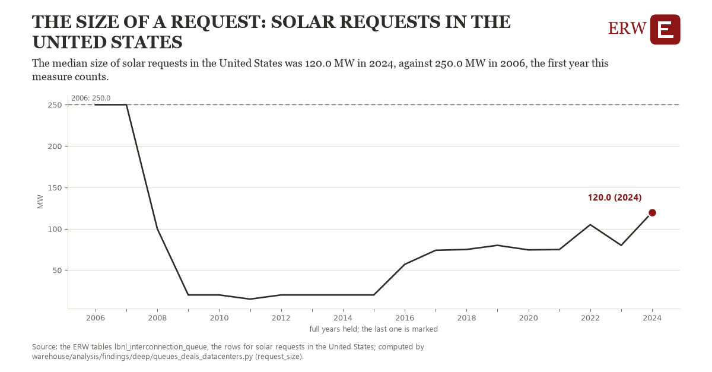

# The size of a request: solar requests in the United States

Draft `scan-deep-806f7662cfe8` of the findings hunt over the whole warehouse (chain 164), 2026-11-06. State: draft, not reviewed. Review at `/internal/findings`.

**The finding.** The median size of solar requests in the United States was 120.0 MW in 2024, against 250.0 MW in 2006, the first year this measure counts.

**The figure by full year** (MW): 2006: 250.0, 2007: 250.0, 2008: 100.0, 2009: 20.0, 2010: 20.0, 2011: 15.0, 2012: 20.0, 2013: 20.0, 2014: 20.0, 2015: 20.0, 2016: 57.0, 2017: 74.0, 2018: 75.0, 2019: 80.0, 2020: 74.5, 2021: 74.9, 2022: 105.0, 2023: 80.0, 2024: 120.0.

**The tables and rows.** `lbnl_interconnection_queue`; the rows for solar requests in the United States, region key `us_type_solar_size` (the card's `hunt.region`), years 2006 to 2024. The yearly values: `request-size-us-type-solar-size.csv`.

**Its strength.** The change is 17.54 typical yearly moves (a typical move is 7.4 MW, 1.4826 times the median absolute change between full years). Holds in more than one year: 17 of the 18 full years after 2006 lie below 2006's value. Survives a change of window: from 2007 to 2024 the change is -130.0, from 2006 to 2023 it is -170.0. Sample large enough: 2006 holds 1 and 2024 holds 1 observations; the floor is 1. Half the change remains without the first year: from 2007 to 2024 the change is -130.0, 100.0 percent of the change from 2006. At least one typical yearly move: the change is 17.54 typical yearly moves (7.4 MW a year, the median move between full years); the floor is 1.

**Its limits.** Berkeley Lab's Queued Up as the ERW holds it (CC BY 4.0, Lawrence Berkeley National Laboratory and GridTracker); a request's dates are those its transmission provider published, and some providers list no withdrawal date. A request's MW is its first type's; a year needs at least ten requests of the type.

**Reproduce.** `python request-size-us-type-solar-size.reproduce.py <the table's CSV>` and `do request-size-us-type-solar-size.reproduce.do` (Stata) recompute the figures by year from the tables as the public downloads hold them; each names the expected values at its top.
