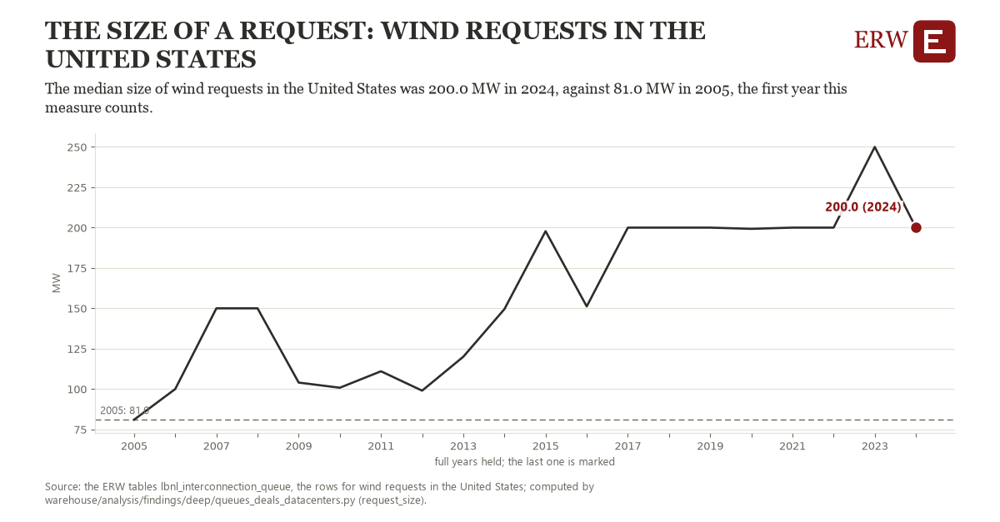

# The size of a request: wind requests in the United States

Draft `scan-deep-b02935a8e929` of the findings hunt over the whole warehouse (chain 164), 2026-11-06. State: draft, not reviewed. Review at `/internal/findings`.

**The finding.** The median size of wind requests in the United States was 200.0 MW in 2024, against 81.0 MW in 2005, the first year this measure counts.

**The figure by full year** (MW): 2005: 81.0, 2006: 100.0, 2007: 150.0, 2008: 150.0, 2009: 104.0, 2010: 100.8, 2011: 111.0, 2012: 99.0, 2013: 120.0, 2014: 149.5, 2015: 197.8, 2016: 151.2, 2017: 200.0, 2018: 200.0, 2019: 200.0, 2020: 199.2, 2021: 200.0, 2022: 200.0, 2023: 250.0, 2024: 200.0.

**The tables and rows.** `lbnl_interconnection_queue`; the rows for wind requests in the United States, region key `us_type_wind_size` (the card's `hunt.region`), years 2005 to 2024. The yearly values: `request-size-us-type-wind-size.csv`.

**Its strength.** The change is 4.22 typical yearly moves (a typical move is 28.2 MW, 1.4826 times the median absolute change between full years). Holds in more than one year: 19 of the 19 full years after 2005 lie above 2005's value. Survives a change of window: from 2006 to 2024 the change is 100.0, from 2005 to 2023 it is 169.0. Sample large enough: 2005 holds 1 and 2024 holds 1 observations; the floor is 1. Half the change remains without the first year: from 2006 to 2024 the change is 100.0, 84.0 percent of the change from 2005. At least one typical yearly move: the change is 4.22 typical yearly moves (28.2 MW a year, the median move between full years); the floor is 1.

**Its limits.** Berkeley Lab's Queued Up as the ERW holds it (CC BY 4.0, Lawrence Berkeley National Laboratory and GridTracker); a request's dates are those its transmission provider published, and some providers list no withdrawal date. A request's MW is its first type's; a year needs at least ten requests of the type.

**Reproduce.** `python request-size-us-type-wind-size.reproduce.py <the table's CSV>` and `do request-size-us-type-wind-size.reproduce.do` (Stata) recompute the figures by year from the tables as the public downloads hold them; each names the expected values at its top.
