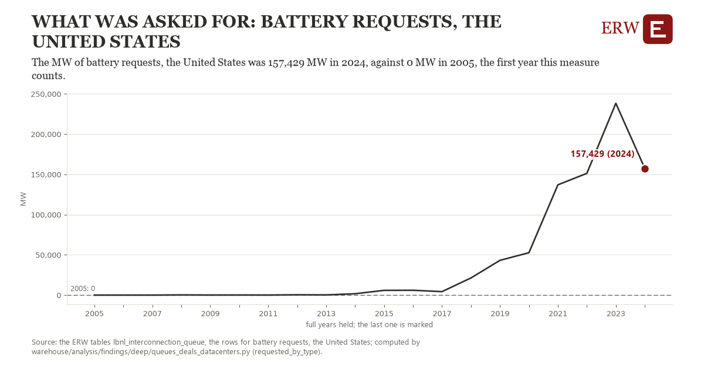

# What was asked for: battery requests, the United States

Draft `scan-deep-3f1caaff9a19` of the findings hunt over the whole warehouse (chain 164), 2026-11-06. State: draft, not reviewed. Review at `/internal/findings`.

**The finding.** The MW of battery requests, the United States was 157,429 MW in 2024, against 0 MW in 2005, the first year this measure counts.

**The figure by full year** (MW): 2005: 0, 2006: 0, 2007: 0, 2008: 201, 2009: 74, 2010: 104, 2011: 60, 2012: 343, 2013: 220, 2014: 1,645, 2015: 5,870, 2016: 5,970, 2017: 4,281, 2018: 21,290, 2019: 43,149, 2020: 52,676, 2021: 137,006, 2022: 151,270, 2023: 238,327, 2024: 157,429.

**The tables and rows.** `lbnl_interconnection_queue`; the rows for battery requests, the United States, region key `us_req_battery` (the card's `hunt.region`), years 2005 to 2024. The yearly values: `requested-by-type-us-req-battery.csv`.

**Its strength.** The change is 74.56 typical yearly moves (a typical move is 2,111 MW, 1.4826 times the median absolute change between full years). Holds in more than one year: 17 of the 19 full years after 2005 lie above 2005's value. Survives a change of window: from 2006 to 2024 the change is 157,429, from 2005 to 2023 it is 238,327. Sample large enough: 2005 holds 1 and 2024 holds 1 observations; the floor is 1. Half the change remains without the first year: from 2006 to 2024 the change is 157,429, 100.0 percent of the change from 2005. At least one typical yearly move: the change is 74.56 typical yearly moves (2,111 MW a year, the median move between full years); the floor is 1.

**Its limits.** Berkeley Lab's Queued Up as the ERW holds it (CC BY 4.0, Lawrence Berkeley National Laboratory and GridTracker); a request's dates are those its transmission provider published, and some providers list no withdrawal date. A request is counted in its queue year whatever became of it; hybrids are counted by their first type.

**Reproduce.** `python requested-by-type-us-req-battery.reproduce.py <the table's CSV>` and `do requested-by-type-us-req-battery.reproduce.do` (Stata) recompute the figures by year from the tables as the public downloads hold them; each names the expected values at its top.
