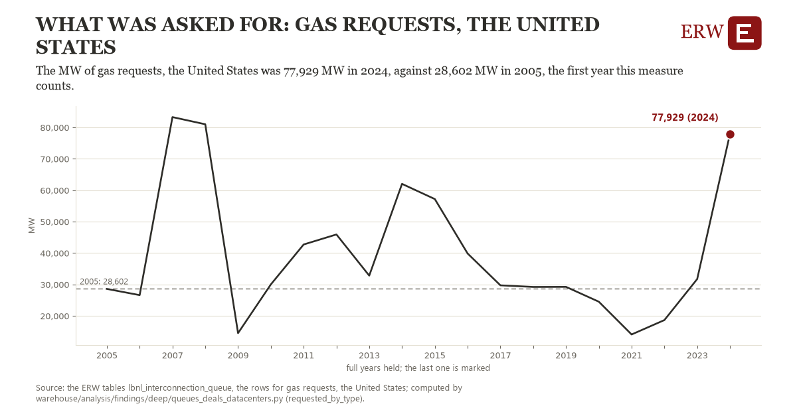

# What was asked for: gas requests, the United States

Draft `scan-deep-58c11e815e84` of the findings hunt over the whole warehouse (chain 164), 2026-11-06. State: draft, not reviewed. Review at `/internal/findings`.

**The finding.** The MW of gas requests, the United States was 77,929 MW in 2024, against 28,602 MW in 2005, the first year this measure counts.

**The figure by full year** (MW): 2005: 28,602, 2006: 26,626, 2007: 83,300, 2008: 81,018, 2009: 14,526, 2010: 30,031, 2011: 42,741, 2012: 45,934, 2013: 32,830, 2014: 62,038, 2015: 57,205, 2016: 39,868, 2017: 29,743, 2018: 29,229, 2019: 29,257, 2020: 24,532, 2021: 14,098, 2022: 18,677, 2023: 31,737, 2024: 77,929.

**The tables and rows.** `lbnl_interconnection_queue`; the rows for gas requests, the United States, region key `us_req_gas` (the card's `hunt.region`), years 2005 to 2024. The yearly values: `requested-by-type-us-req-gas.csv`.

**Its strength.** The change is 3.19 typical yearly moves (a typical move is 15,470 MW, 1.4826 times the median absolute change between full years). Holds in more than one year: 14 of the 19 full years after 2005 lie above 2005's value. Survives a change of window: from 2006 to 2024 the change is 51,303, from 2005 to 2023 it is 3,135. Sample large enough: 2005 holds 1 and 2024 holds 1 observations; the floor is 1. Half the change remains without the first year: from 2006 to 2024 the change is 51,303, 104.0 percent of the change from 2005. At least one typical yearly move: the change is 3.19 typical yearly moves (15,470 MW a year, the median move between full years); the floor is 1.

**Its limits.** Berkeley Lab's Queued Up as the ERW holds it (CC BY 4.0, Lawrence Berkeley National Laboratory and GridTracker); a request's dates are those its transmission provider published, and some providers list no withdrawal date. A request is counted in its queue year whatever became of it; hybrids are counted by their first type.

**Reproduce.** `python requested-by-type-us-req-gas.reproduce.py <the table's CSV>` and `do requested-by-type-us-req-gas.reproduce.do` (Stata) recompute the figures by year from the tables as the public downloads hold them; each names the expected values at its top.
