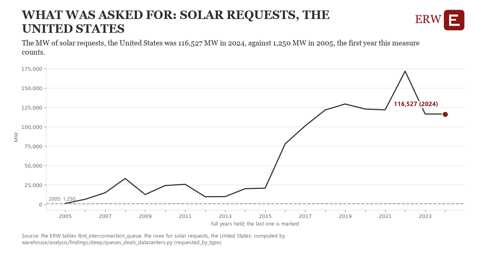

# What was asked for: solar requests, the United States

Draft `scan-deep-cdf5f79c521a` of the findings hunt over the whole warehouse (chain 164), 2026-11-06. State: draft, not reviewed. Review at `/internal/findings`.

**The finding.** The MW of solar requests, the United States was 116,527 MW in 2024, against 1,250 MW in 2005, the first year this measure counts.

**The figure by full year** (MW): 2005: 1,250, 2006: 6,574, 2007: 15,022, 2008: 33,442, 2009: 12,694, 2010: 24,300, 2011: 25,919, 2012: 9,927, 2013: 10,050, 2014: 20,235, 2015: 20,927, 2016: 78,076, 2017: 101,253, 2018: 121,717, 2019: 129,512, 2020: 122,953, 2021: 121,943, 2022: 171,777, 2023: 116,619, 2024: 116,527.

**The tables and rows.** `lbnl_interconnection_queue`; the rows for solar requests, the United States, region key `us_req_solar` (the card's `hunt.region`), years 2005 to 2024. The yearly values: `requested-by-type-us-req-solar.csv`.

**Its strength.** The change is 7.63 typical yearly moves (a typical move is 15,100 MW, 1.4826 times the median absolute change between full years). Holds in more than one year: 19 of the 19 full years after 2005 lie above 2005's value. Survives a change of window: from 2006 to 2024 the change is 109,952, from 2005 to 2023 it is 115,369. Sample large enough: 2005 holds 1 and 2024 holds 1 observations; the floor is 1. Half the change remains without the first year: from 2006 to 2024 the change is 109,952, 95.4 percent of the change from 2005. At least one typical yearly move: the change is 7.63 typical yearly moves (15,100 MW a year, the median move between full years); the floor is 1.

**Its limits.** Berkeley Lab's Queued Up as the ERW holds it (CC BY 4.0, Lawrence Berkeley National Laboratory and GridTracker); a request's dates are those its transmission provider published, and some providers list no withdrawal date. A request is counted in its queue year whatever became of it; hybrids are counted by their first type.

**Reproduce.** `python requested-by-type-us-req-solar.reproduce.py <the table's CSV>` and `do requested-by-type-us-req-solar.reproduce.do` (Stata) recompute the figures by year from the tables as the public downloads hold them; each names the expected values at its top.
