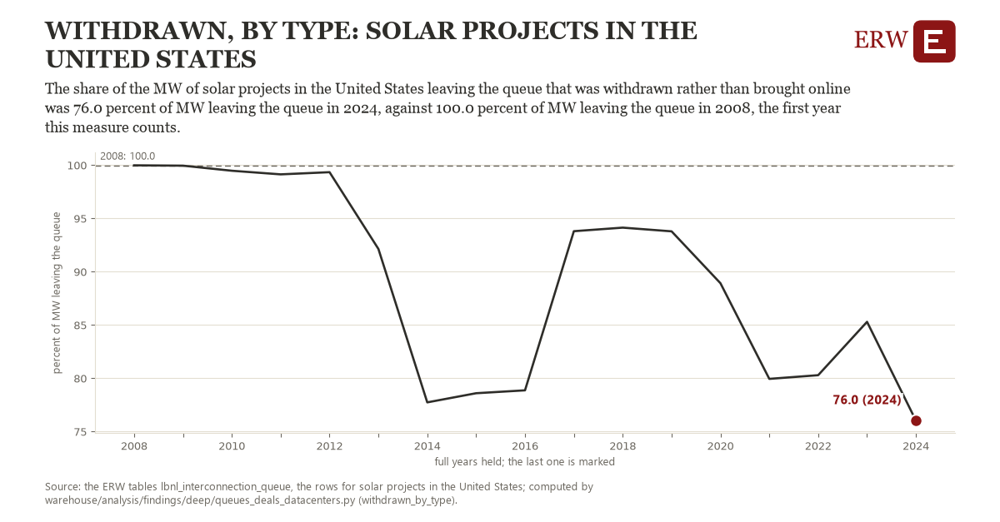

# Withdrawn, by type: solar projects in the United States

Draft `scan-deep-58bdd2d65c59` of the findings hunt over the whole warehouse (chain 164), 2026-11-06. State: draft, not reviewed. Review at `/internal/findings`.

**The finding.** The share of the MW of solar projects in the United States leaving the queue that was withdrawn rather than brought online was 76.0 percent of MW leaving the queue in 2024, against 100.0 percent of MW leaving the queue in 2008, the first year this measure counts.

**The figure by full year** (percent of MW leaving the queue): 2008: 100.0, 2009: 100.0, 2010: 99.5, 2011: 99.1, 2012: 99.3, 2013: 92.1, 2014: 77.7, 2015: 78.6, 2016: 78.9, 2017: 93.8, 2018: 94.1, 2019: 93.8, 2020: 88.9, 2021: 79.9, 2022: 80.3, 2023: 85.3, 2024: 76.0.

**The tables and rows.** `lbnl_interconnection_queue`; the rows for solar projects in the United States, region key `us_type_solar_wd` (the card's `hunt.region`), years 2008 to 2024. The yearly values: `withdrawn-by-type-us-type-solar-wd.csv`.

**Its strength.** The change is 24.20 typical yearly moves (a typical move is 1.0 percent of MW leaving the queue, 1.4826 times the median absolute change between full years). Holds in more than one year: 16 of the 16 full years after 2008 lie below 2008's value. Survives a change of window: from 2009 to 2024 the change is -23.9, from 2008 to 2023 it is -14.7. Sample large enough: 2008 holds 1 and 2024 holds 1 observations; the floor is 1. Half the change remains without the first year: from 2009 to 2024 the change is -23.9, 99.9 percent of the change from 2008. At least one typical yearly move: the change is 24.20 typical yearly moves (1.0 percent of MW leaving the queue a year, the median move between full years); the floor is 1.

**Its limits.** Berkeley Lab's Queued Up as the ERW holds it (CC BY 4.0, Lawrence Berkeley National Laboratory and GridTracker); a request's dates are those its transmission provider published, and some providers list no withdrawal date. A year's exits mix requests of many queue years; a year counts when both exits are held in it; a hybrid counts as its first type.

**Reproduce.** `python withdrawn-by-type-us-type-solar-wd.reproduce.py <the table's CSV>` and `do withdrawn-by-type-us-type-solar-wd.reproduce.do` (Stata) recompute the figures by year from the tables as the public downloads hold them; each names the expected values at its top.
