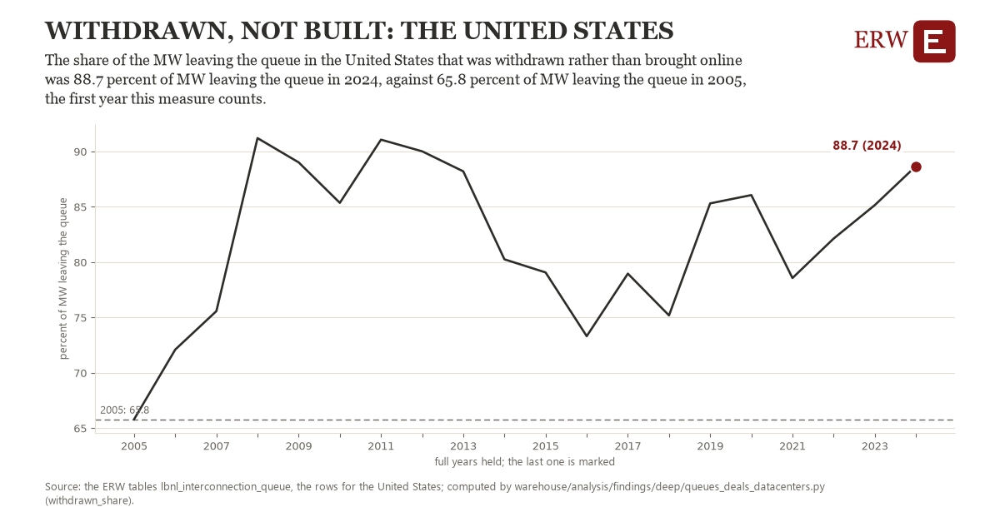

# Withdrawn, not built: the United States

Draft `scan-deep-72e9a2889ce4` of the findings hunt over the whole warehouse (chain 164), 2026-11-06. State: draft, not reviewed. Review at `/internal/findings`.

**The finding.** The share of the MW leaving the queue in the United States that was withdrawn rather than brought online was 88.7 percent of MW leaving the queue in 2024, against 65.8 percent of MW leaving the queue in 2005, the first year this measure counts.

**The figure by full year** (percent of MW leaving the queue): 2005: 65.8, 2006: 72.1, 2007: 75.6, 2008: 91.2, 2009: 89.0, 2010: 85.4, 2011: 91.1, 2012: 90.0, 2013: 88.2, 2014: 80.3, 2015: 79.1, 2016: 73.3, 2017: 79.0, 2018: 75.2, 2019: 85.3, 2020: 86.1, 2021: 78.6, 2022: 82.1, 2023: 85.1, 2024: 88.7.

**The tables and rows.** `lbnl_interconnection_queue`; the rows for the United States, region key `us_lbnl_wd` (the card's `hunt.region`), years 2005 to 2024. The yearly values: `withdrawn-share-us-lbnl-wd.csv`.

**Its strength.** The change is 4.22 typical yearly moves (a typical move is 5.4 percent of MW leaving the queue, 1.4826 times the median absolute change between full years). Holds in more than one year: 19 of the 19 full years after 2005 lie above 2005's value. Survives a change of window: from 2006 to 2024 the change is 16.6, from 2005 to 2023 it is 19.3. Sample large enough: 2005 holds 1 and 2024 holds 1 observations; the floor is 1. Half the change remains without the first year: from 2006 to 2024 the change is 16.6, 72.5 percent of the change from 2005. At least one typical yearly move: the change is 4.22 typical yearly moves (5.4 percent of MW leaving the queue a year, the median move between full years); the floor is 1.

**Its limits.** Berkeley Lab's Queued Up as the ERW holds it (CC BY 4.0, Lawrence Berkeley National Laboratory and GridTracker); a request's dates are those its transmission provider published, and some providers list no withdrawal date. A year's exits mix requests of many queue years; a year counts when both exits are held in it.

**Reproduce.** `python withdrawn-share-us-lbnl-wd.reproduce.py <the table's CSV>` and `do withdrawn-share-us-lbnl-wd.reproduce.do` (Stata) recompute the figures by year from the tables as the public downloads hold them; each names the expected values at its top.
