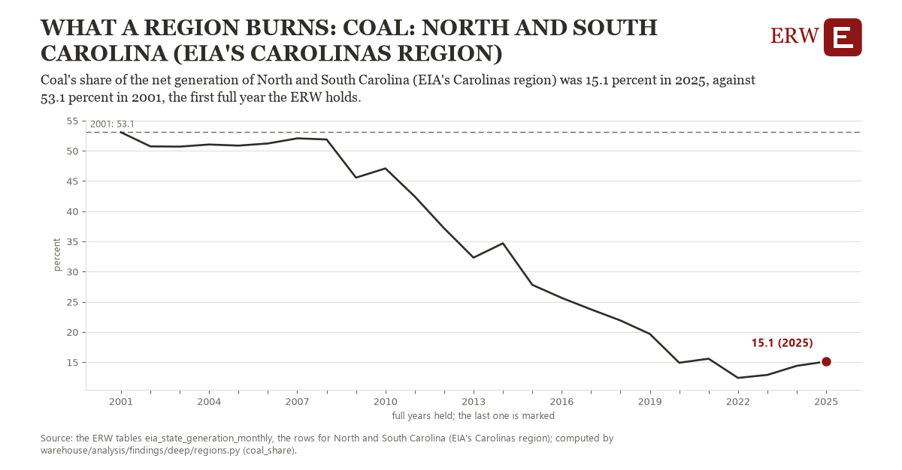

# What a region burns: coal: North and South Carolina (EIA's Carolinas region)

Draft `scan-deep-c3c1e2adc4de` of the findings hunt over the whole warehouse (chain 502), 2026-11-19. State: draft, not reviewed. Review at `/internal/findings`.

**The finding.** Coal's share of the net generation of North and South Carolina (EIA's Carolinas region) was 15.1 percent in 2025, against 53.1 percent in 2001, the first full year the ERW holds.

**The figure by full year** (percent): 2001: 53.1, 2002: 50.7, 2003: 50.7, 2004: 51.0, 2005: 50.9, 2006: 51.2, 2007: 52.1, 2008: 51.9, 2009: 45.6, 2010: 47.1, 2011: 42.4, 2012: 37.2, 2013: 32.3, 2014: 34.7, 2015: 27.8, 2016: 25.7, 2017: 23.7, 2018: 21.9, 2019: 19.7, 2020: 14.9, 2021: 15.6, 2022: 12.4, 2023: 12.9, 2024: 14.4, 2025: 15.1.

**The tables and rows.** `eia_state_generation_monthly`; the rows for North and South Carolina (EIA's Carolinas region), region key `st_car_cow` (the card's `hunt.region`), years 2001 to 2025. The yearly values: `coal-share-st-car-cow.csv`.

**Its strength.** The change is 13.66 typical yearly moves (a typical move is 2.8 percent, 1.4826 times the median absolute change between full years). Holds in more than one year: 24 of the 24 full years after 2001 lie below 2001's value. Survives a change of window: from 2002 to 2025 the change is -35.6, from 2001 to 2024 it is -38.7. Sample large enough: 2001 holds 12 and 2025 holds 12 observations; the floor is 12. Half the change remains without the first year: from 2002 to 2025 the change is -35.6, 93.9 percent of the change from 2001. At least one typical yearly move: the change is 13.66 typical yearly moves (2.8 percent a year, the median move between full years); the floor is 1.

**Its limits.** EIA's state net generation by fuel, all sectors; the states stand for the region and are not its footprint; the latest months are preliminary.

**Reproduce.** `python coal-share-st-car-cow.reproduce.py <the table's CSV>` and `do coal-share-st-car-cow.reproduce.do` (Stata) recompute the figures by year from the tables as the public downloads hold them; each names the expected values at its top.
