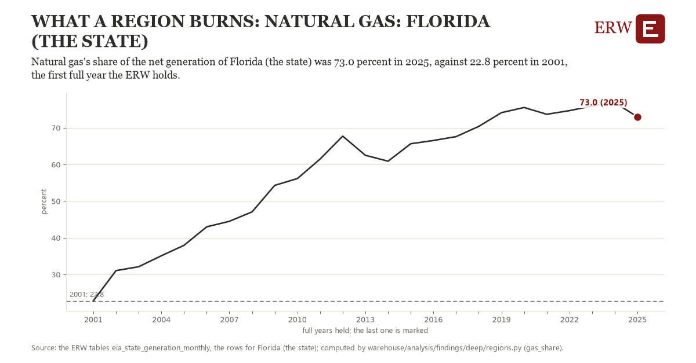

# What a region burns: natural gas: Florida (the state)

Draft `scan-deep-96d974164952` of the findings hunt over the whole warehouse (chain 502), 2026-11-19. State: draft, not reviewed. Review at `/internal/findings`.

**The finding.** Natural gas's share of the net generation of Florida (the state) was 73.0 percent in 2025, against 22.8 percent in 2001, the first full year the ERW holds.

**The figure by full year** (percent): 2001: 22.8, 2002: 31.1, 2003: 32.1, 2004: 35.1, 2005: 38.0, 2006: 43.0, 2007: 44.5, 2008: 47.1, 2009: 54.3, 2010: 56.1, 2011: 61.5, 2012: 67.7, 2013: 62.5, 2014: 60.9, 2015: 65.6, 2016: 66.5, 2017: 67.6, 2018: 70.4, 2019: 74.1, 2020: 75.5, 2021: 73.7, 2022: 74.7, 2023: 75.9, 2024: 76.8, 2025: 73.0.

**The tables and rows.** `eia_state_generation_monthly`; the rows for Florida (the state), region key `st_fla_ng` (the card's `hunt.region`), years 2001 to 2025. The yearly values: `gas-share-st-fla-ng.csv`.

**Its strength.** The change is 12.63 typical yearly moves (a typical move is 4.0 percent, 1.4826 times the median absolute change between full years). Holds in more than one year: 24 of the 24 full years after 2001 lie above 2001's value. Survives a change of window: from 2002 to 2025 the change is 41.9, from 2001 to 2024 it is 54.0. Sample large enough: 2001 holds 12 and 2025 holds 12 observations; the floor is 12. Half the change remains without the first year: from 2002 to 2025 the change is 41.9, 83.6 percent of the change from 2001. At least one typical yearly move: the change is 12.63 typical yearly moves (4.0 percent a year, the median move between full years); the floor is 1.

**Its limits.** EIA's state net generation by fuel, all sectors; the states stand for the region and are not its footprint; the latest months are preliminary.

**Reproduce.** `python gas-share-st-fla-ng.reproduce.py <the table's CSV>` and `do gas-share-st-fla-ng.reproduce.do` (Stata) recompute the figures by year from the tables as the public downloads hold them; each names the expected values at its top.
