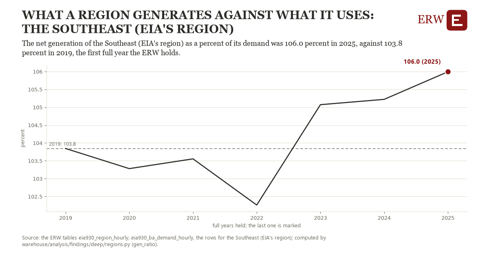

# What a region generates against what it uses: the Southeast (EIA's region)

Draft `scan-deep-b4157b4bec27` of the findings hunt over the whole warehouse (chain 502), 2026-11-19. State: draft, not reviewed. Review at `/internal/findings`.

**The finding.** The net generation of the Southeast (EIA's region) as a percent of its demand was 106.0 percent in 2025, against 103.8 percent in 2019, the first full year the ERW holds.

**The figure by full year** (percent): 2019: 103.8, 2020: 103.3, 2021: 103.6, 2022: 102.3, 2023: 105.1, 2024: 105.2, 2025: 106.0.

**The tables and rows.** `eia930_region_hourly`, `eia930_ba_demand_hourly`; the rows for the Southeast (EIA's region), region key `rg_se` (the card's `hunt.region`), years 2019 to 2025. The yearly values: `gen-ratio-rg-se.csv`.

**Its strength.** The change is 2.17 typical yearly moves (a typical move is 1.0 percent, 1.4826 times the median absolute change between full years). Holds in more than one year: 3 of the 6 full years after 2019 lie above 2019's value. Survives a change of window: from 2020 to 2025 the change is 2.7, from 2019 to 2024 it is 1.4. Sample large enough: 2019 holds 8,759 and 2025 holds 8,760 observations; the floor is 8,000. Half the change remains without the first year: from 2020 to 2025 the change is 2.7, 126.2 percent of the change from 2019. At least one typical yearly move: the change is 2.17 typical yearly moves (1.0 percent a year, the median move between full years); the floor is 1.

**Its limits.** EIA-930 as the authorities report it; net generation includes the authorities that file no demand, and demand is summed from those that do, hours both are held.

**Reproduce.** `python gen-ratio-rg-se.reproduce.py <the table's CSV>` and `do gen-ratio-rg-se.reproduce.do` (Stata) recompute the figures by year from the tables as the public downloads hold them; each names the expected values at its top.
