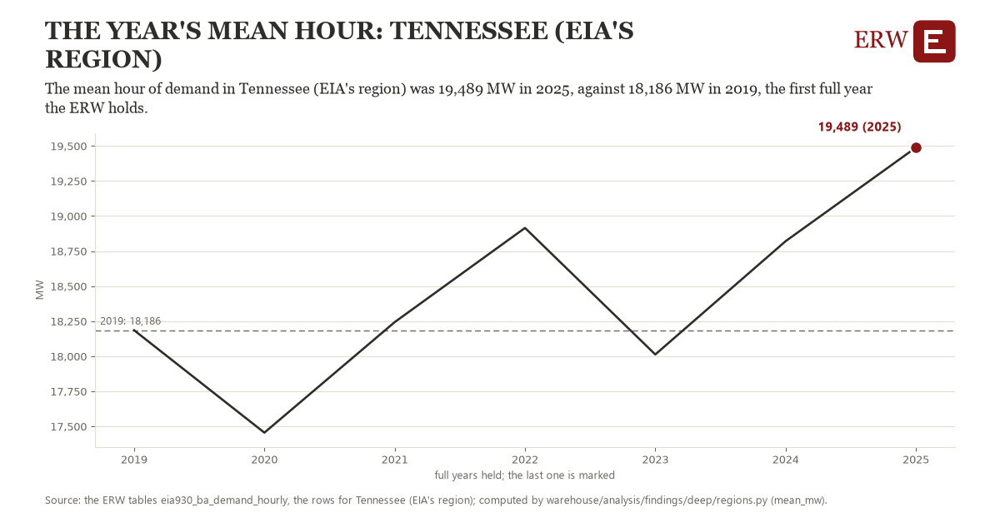

# The year's mean hour: Tennessee (EIA's region)

Draft `scan-deep-e774c2577588` of the findings hunt over the whole warehouse (chain 502), 2026-11-19. State: draft, not reviewed. Review at `/internal/findings`.

**The finding.** The mean hour of demand in Tennessee (EIA's region) was 19,489 MW in 2025, against 18,186 MW in 2019, the first full year the ERW holds.

**The figure by full year** (MW): 2019: 18,186, 2020: 17,455, 2021: 18,243, 2022: 18,915, 2023: 18,013, 2024: 18,821, 2025: 19,489.

**The tables and rows.** `eia930_ba_demand_hourly`; the rows for Tennessee (EIA's region), region key `rd_ten` (the card's `hunt.region`), years 2019 to 2025. The yearly values: `mean-mw-rd-ten.csv`.

**Its strength.** The change is 1.16 typical yearly moves (a typical move is 1,126 MW, 1.4826 times the median absolute change between full years). Holds in more than one year: 4 of the 6 full years after 2019 lie above 2019's value. Survives a change of window: from 2020 to 2025 the change is 2,033, from 2019 to 2024 it is 635. Sample large enough: 2019 holds 8,760 and 2025 holds 8,760 observations; the floor is 8,000. Half the change remains without the first year: from 2020 to 2025 the change is 2,033, 156.1 percent of the change from 2019. At least one typical yearly move: the change is 1.16 typical yearly moves (1,126 MW a year, the median move between full years); the floor is 1.

**Its limits.** EIA-930 as the balancing authorities report it; a region's demand is the sum of its authorities that file demand, an hour held only when all of them do; not adjusted for weather.

**Reproduce.** `python mean-mw-rd-ten.reproduce.py <the table's CSV>` and `do mean-mw-rd-ten.reproduce.do` (Stata) recompute the figures by year from the tables as the public downloads hold them; each names the expected values at its top.
