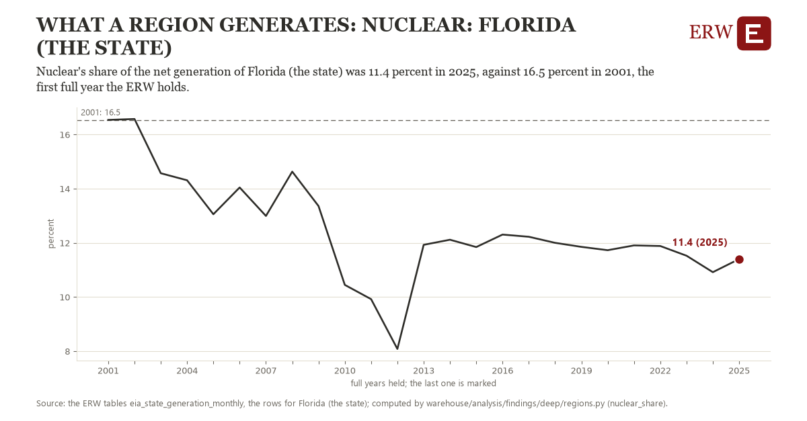

# What a region generates: nuclear: Florida (the state)

Draft `scan-deep-28ad8b19b018` of the findings hunt over the whole warehouse (chain 502), 2026-11-19. State: draft, not reviewed. Review at `/internal/findings`.

**The finding.** Nuclear's share of the net generation of Florida (the state) was 11.4 percent in 2025, against 16.5 percent in 2001, the first full year the ERW holds.

**The figure by full year** (percent): 2001: 16.5, 2002: 16.6, 2003: 14.6, 2004: 14.3, 2005: 13.1, 2006: 14.0, 2007: 13.0, 2008: 14.6, 2009: 13.4, 2010: 10.4, 2011: 9.9, 2012: 8.1, 2013: 11.9, 2014: 12.1, 2015: 11.8, 2016: 12.3, 2017: 12.2, 2018: 12.0, 2019: 11.9, 2020: 11.7, 2021: 11.9, 2022: 11.9, 2023: 11.5, 2024: 10.9, 2025: 11.4.

**The tables and rows.** `eia_state_generation_monthly`; the rows for Florida (the state), region key `st_fla_nuc` (the card's `hunt.region`), years 2001 to 2025. The yearly values: `nuclear-share-st-fla-nuc.csv`.

**Its strength.** The change is 7.33 typical yearly moves (a typical move is 0.7 percent, 1.4826 times the median absolute change between full years). Holds in more than one year: 23 of the 24 full years after 2001 lie below 2001's value. Survives a change of window: from 2002 to 2025 the change is -5.2, from 2001 to 2024 it is -5.6. Sample large enough: 2001 holds 12 and 2025 holds 12 observations; the floor is 12. Half the change remains without the first year: from 2002 to 2025 the change is -5.2, 100.7 percent of the change from 2001. At least one typical yearly move: the change is 7.33 typical yearly moves (0.7 percent a year, the median move between full years); the floor is 1.

**Its limits.** EIA's state net generation by fuel, all sectors; the states stand for the region and are not its footprint; the latest months are preliminary.

**Reproduce.** `python nuclear-share-st-fla-nuc.reproduce.py <the table's CSV>` and `do nuclear-share-st-fla-nuc.reproduce.do` (Stata) recompute the figures by year from the tables as the public downloads hold them; each names the expected values at its top.
