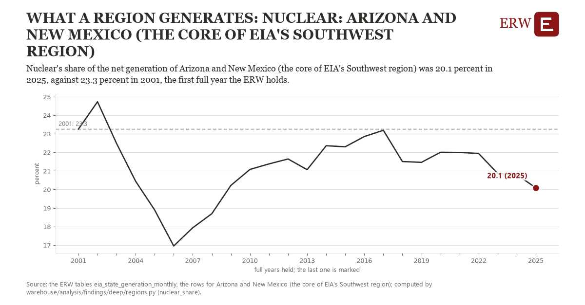

# What a region generates: nuclear: Arizona and New Mexico (the core of EIA's Southwest region)

Draft `scan-deep-8a38fc7985c5` of the findings hunt over the whole warehouse (chain 502), 2026-11-19. State: draft, not reviewed. Review at `/internal/findings`.

**The finding.** Nuclear's share of the net generation of Arizona and New Mexico (the core of EIA's Southwest region) was 20.1 percent in 2025, against 23.3 percent in 2001, the first full year the ERW holds.

**The figure by full year** (percent): 2001: 23.3, 2002: 24.7, 2003: 22.5, 2004: 20.4, 2005: 18.9, 2006: 17.0, 2007: 17.9, 2008: 18.7, 2009: 20.2, 2010: 21.1, 2011: 21.4, 2012: 21.6, 2013: 21.1, 2014: 22.4, 2015: 22.3, 2016: 22.9, 2017: 23.2, 2018: 21.5, 2019: 21.5, 2020: 22.0, 2021: 22.0, 2022: 21.9, 2023: 20.9, 2024: 20.8, 2025: 20.1.

**The tables and rows.** `eia_state_generation_monthly`; the rows for Arizona and New Mexico (the core of EIA's Southwest region), region key `st_sw_nuc` (the card's `hunt.region`), years 2001 to 2025. The yearly values: `nuclear-share-st-sw-nuc.csv`.

**Its strength.** The change is 2.91 typical yearly moves (a typical move is 1.1 percent, 1.4826 times the median absolute change between full years). Holds in more than one year: 23 of the 24 full years after 2001 lie below 2001's value. Survives a change of window: from 2002 to 2025 the change is -4.6, from 2001 to 2024 it is -2.5. Sample large enough: 2001 holds 12 and 2025 holds 12 observations; the floor is 12. Half the change remains without the first year: from 2002 to 2025 the change is -4.6, 146.7 percent of the change from 2001. At least one typical yearly move: the change is 2.91 typical yearly moves (1.1 percent a year, the median move between full years); the floor is 1.

**Its limits.** EIA's state net generation by fuel, all sectors; the states stand for the region and are not its footprint; the latest months are preliminary.

**Reproduce.** `python nuclear-share-st-sw-nuc.reproduce.py <the table's CSV>` and `do nuclear-share-st-sw-nuc.reproduce.do` (Stata) recompute the figures by year from the tables as the public downloads hold them; each names the expected values at its top.
