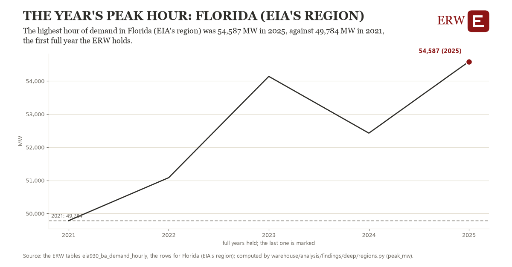

# The year's peak hour: Florida (EIA's region)

Draft `scan-deep-351e7822b9d9` of the findings hunt over the whole warehouse (chain 502), 2026-11-19. State: draft, not reviewed. Review at `/internal/findings`.

**The finding.** The highest hour of demand in Florida (EIA's region) was 54,587 MW in 2025, against 49,784 MW in 2021, the first full year the ERW holds.

**The figure by full year** (MW): 2021: 49,784, 2022: 51,082, 2023: 54,139, 2024: 52,426, 2025: 54,587.

**The tables and rows.** `eia930_ba_demand_hourly`; the rows for Florida (EIA's region), region key `rd_fla` (the card's `hunt.region`), years 2021 to 2025. The yearly values: `peak-mw-rd-fla.csv`.

**Its strength.** The change is 1.67 typical yearly moves (a typical move is 2,872 MW, 1.4826 times the median absolute change between full years). Holds in more than one year: 4 of the 4 full years after 2021 lie above 2021's value. Survives a change of window: from 2022 to 2025 the change is 3,505, from 2021 to 2024 it is 2,642. Sample large enough: 2021 holds 8,595 and 2025 holds 8,739 observations; the floor is 8,000. Half the change remains without the first year: from 2022 to 2025 the change is 3,505, 73.0 percent of the change from 2021. At least one typical yearly move: the change is 1.67 typical yearly moves (2,872 MW a year, the median move between full years); the floor is 1.

**Its limits.** EIA-930 as the balancing authorities report it; a region's demand is the sum of its authorities that file demand, an hour held only when all of them do; not adjusted for weather.

**Reproduce.** `python peak-mw-rd-fla.reproduce.py <the table's CSV>` and `do peak-mw-rd-fla.reproduce.do` (Stata) recompute the figures by year from the tables as the public downloads hold them; each names the expected values at its top.
