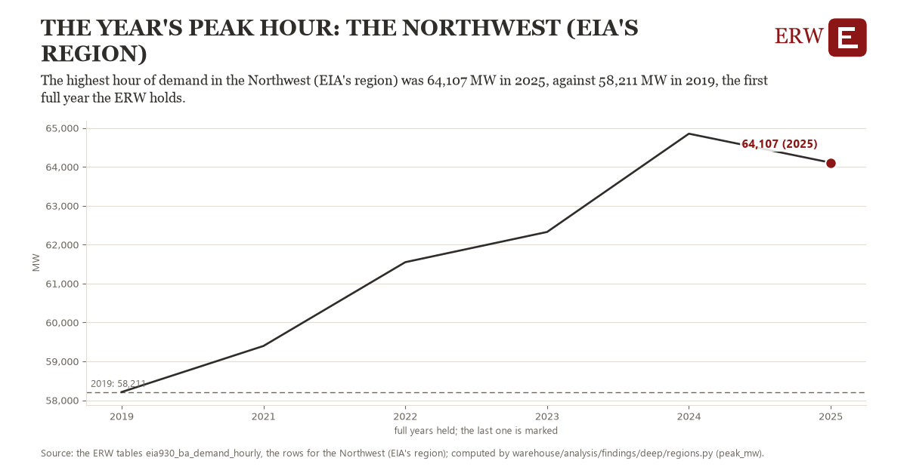

# The year's peak hour: the Northwest (EIA's region)

Draft `scan-deep-00c2877cfdb5` of the findings hunt over the whole warehouse (chain 502), 2026-11-19. State: draft, not reviewed. Review at `/internal/findings`.

**The finding.** The highest hour of demand in the Northwest (EIA's region) was 64,107 MW in 2025, against 58,211 MW in 2019, the first full year the ERW holds.

**The figure by full year** (MW): 2019: 58,211, 2021: 59,395, 2022: 61,549, 2023: 62,326, 2024: 64,852, 2025: 64,107.

**The tables and rows.** `eia930_ba_demand_hourly`; the rows for the Northwest (EIA's region), region key `rd_nw` (the card's `hunt.region`), years 2019 to 2025. The yearly values: `peak-mw-rd-nw.csv`.

**Its strength.** The change is 3.36 typical yearly moves (a typical move is 1,755 MW, 1.4826 times the median absolute change between full years). Holds in more than one year: 5 of the 5 full years after 2019 lie above 2019's value. Survives a change of window: from 2021 to 2025 the change is 4,712, from 2019 to 2024 it is 6,641. Sample large enough: 2019 holds 8,303 and 2025 holds 8,743 observations; the floor is 8,000. Half the change remains without the first year: from 2021 to 2025 the change is 4,712, 79.9 percent of the change from 2019. At least one typical yearly move: the change is 3.36 typical yearly moves (1,755 MW a year, the median move between full years); the floor is 1.

**Its limits.** EIA-930 as the balancing authorities report it; a region's demand is the sum of its authorities that file demand, an hour held only when all of them do; not adjusted for weather.

**Reproduce.** `python peak-mw-rd-nw.reproduce.py <the table's CSV>` and `do peak-mw-rd-nw.reproduce.do` (Stata) recompute the figures by year from the tables as the public downloads hold them; each names the expected values at its top.
