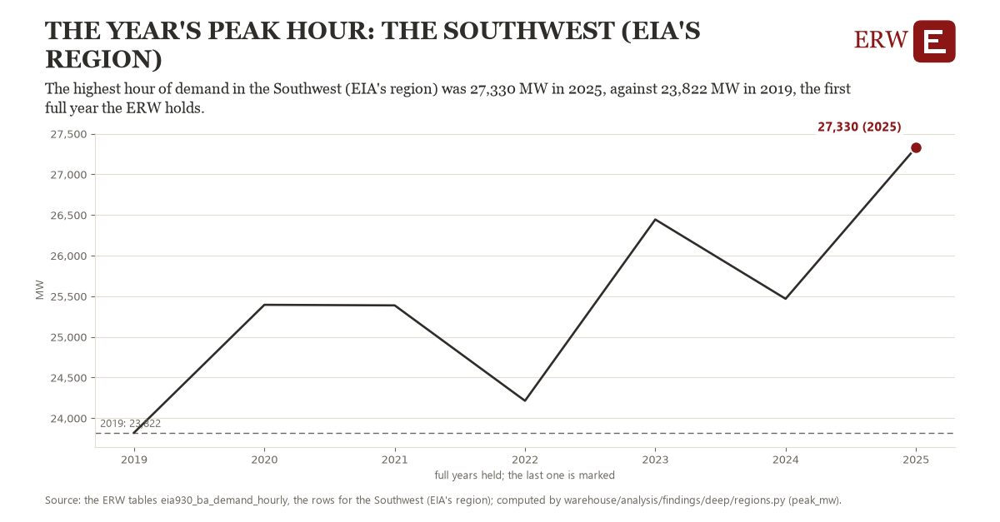

# The year's peak hour: the Southwest (EIA's region)

Draft `scan-deep-083166eed77d` of the findings hunt over the whole warehouse (chain 502), 2026-11-19. State: draft, not reviewed. Review at `/internal/findings`.

**The finding.** The highest hour of demand in the Southwest (EIA's region) was 27,330 MW in 2025, against 23,822 MW in 2019, the first full year the ERW holds.

**The figure by full year** (MW): 2019: 23,822, 2020: 25,395, 2021: 25,388, 2022: 24,214, 2023: 26,445, 2024: 25,469, 2025: 27,330.

**The tables and rows.** `eia930_ba_demand_hourly`; the rows for the Southwest (EIA's region), region key `rd_sw` (the card's `hunt.region`), years 2019 to 2025. The yearly values: `peak-mw-rd-sw.csv`.

**Its strength.** The change is 1.72 typical yearly moves (a typical move is 2,036 MW, 1.4826 times the median absolute change between full years). Holds in more than one year: 6 of the 6 full years after 2019 lie above 2019's value. Survives a change of window: from 2020 to 2025 the change is 1,935, from 2019 to 2024 it is 1,647. Sample large enough: 2019 holds 8,708 and 2025 holds 8,760 observations; the floor is 8,000. Half the change remains without the first year: from 2020 to 2025 the change is 1,935, 55.2 percent of the change from 2019. At least one typical yearly move: the change is 1.72 typical yearly moves (2,036 MW a year, the median move between full years); the floor is 1.

**Its limits.** EIA-930 as the balancing authorities report it; a region's demand is the sum of its authorities that file demand, an hour held only when all of them do; not adjusted for weather.

**Reproduce.** `python peak-mw-rd-sw.reproduce.py <the table's CSV>` and `do peak-mw-rd-sw.reproduce.do` (Stata) recompute the figures by year from the tables as the public downloads hold them; each names the expected values at its top.
