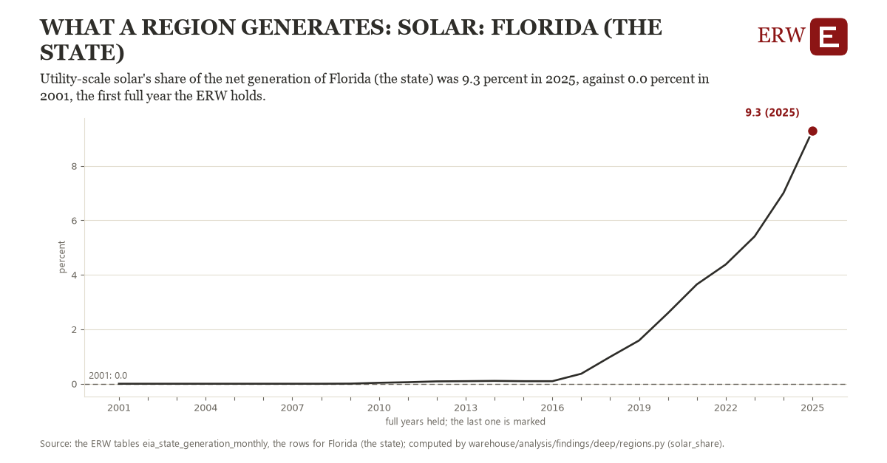

# What a region generates: solar: Florida (the state)

Draft `scan-deep-0358bf8e86a1` of the findings hunt over the whole warehouse (chain 502), 2026-11-19. State: draft, not reviewed. Review at `/internal/findings`.

**The finding.** Utility-scale solar's share of the net generation of Florida (the state) was 9.3 percent in 2025, against 0.0 percent in 2001, the first full year the ERW holds.

**The figure by full year** (percent): 2001: 0.0, 2002: 0.0, 2003: 0.0, 2004: 0.0, 2005: 0.0, 2006: 0.0, 2007: 0.0, 2008: 0.0, 2009: 0.0, 2010: 0.0, 2011: 0.1, 2012: 0.1, 2013: 0.1, 2014: 0.1, 2015: 0.1, 2016: 0.1, 2017: 0.4, 2018: 1.0, 2019: 1.6, 2020: 2.6, 2021: 3.7, 2022: 4.4, 2023: 5.4, 2024: 7.0, 2025: 9.3.

**The tables and rows.** `eia_state_generation_monthly`; the rows for Florida (the state), region key `st_fla_sun` (the card's `hunt.region`), years 2001 to 2025. The yearly values: `solar-share-st-fla-sun.csv`.

**Its strength.** The change is 387.91 typical yearly moves (a typical move is 0.0 percent, 1.4826 times the median absolute change between full years). Holds in more than one year: 17 of the 24 full years after 2001 lie above 2001's value. Survives a change of window: from 2002 to 2025 the change is 9.3, from 2001 to 2024 it is 7.0. Sample large enough: 2001 holds 12 and 2025 holds 12 observations; the floor is 12. Half the change remains without the first year: from 2002 to 2025 the change is 9.3, 100.0 percent of the change from 2001. At least one typical yearly move: the change is 387.91 typical yearly moves (0.0 percent a year, the median move between full years); the floor is 1.

**Its limits.** EIA's state net generation by fuel, all sectors; the states stand for the region and are not its footprint; the latest months are preliminary. Small rooftop systems are not in this figure.

**Reproduce.** `python solar-share-st-fla-sun.reproduce.py <the table's CSV>` and `do solar-share-st-fla-sun.reproduce.do` (Stata) recompute the figures by year from the tables as the public downloads hold them; each names the expected values at its top.
