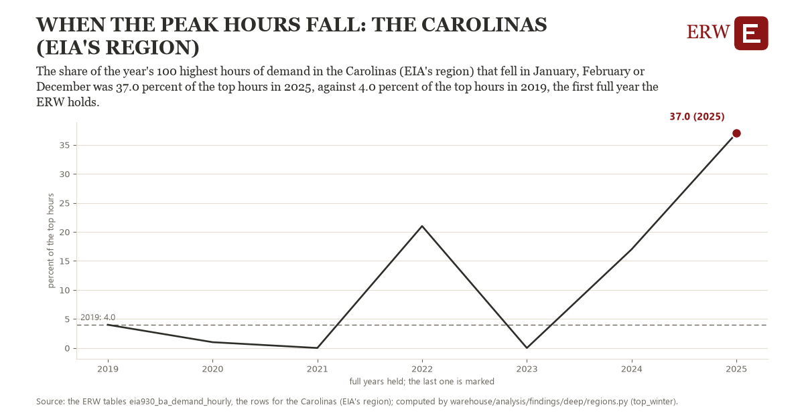

# When the peak hours fall: the Carolinas (EIA's region)

Draft `scan-deep-a4449b343aba` of the findings hunt over the whole warehouse (chain 502), 2026-11-19. State: draft, not reviewed. Review at `/internal/findings`.

**The finding.** The share of the year's 100 highest hours of demand in the Carolinas (EIA's region) that fell in January, February or December was 37.0 percent of the top hours in 2025, against 4.0 percent of the top hours in 2019, the first full year the ERW holds.

**The figure by full year** (percent of the top hours): 2019: 4.0, 2020: 1.0, 2021: 0.0, 2022: 21.0, 2023: 0.0, 2024: 17.0, 2025: 37.0.

**The tables and rows.** `eia930_ba_demand_hourly`; the rows for the Carolinas (EIA's region), region key `rd_car` (the card's `hunt.region`), years 2019 to 2025. The yearly values: `top-winter-rd-car.csv`.

**Its strength.** The change is 1.20 typical yearly moves (a typical move is 27.4 percent of the top hours, 1.4826 times the median absolute change between full years). Holds in more than one year: 3 of the 6 full years after 2019 lie above 2019's value. Survives a change of window: from 2020 to 2025 the change is 36.0, from 2019 to 2024 it is 13.0. Sample large enough: 2019 holds 8,758 and 2025 holds 8,711 observations; the floor is 8,000. Half the change remains without the first year: from 2020 to 2025 the change is 36.0, 109.1 percent of the change from 2019. At least one typical yearly move: the change is 1.20 typical yearly moves (27.4 percent of the top hours a year, the median move between full years); the floor is 1.

**Its limits.** EIA-930 as the balancing authorities report it; a region's demand is the sum of its authorities that file demand, an hour held only when all of them do; not adjusted for weather. Months are UTC months.

**Reproduce.** `python top-winter-rd-car.reproduce.py <the table's CSV>` and `do top-winter-rd-car.reproduce.do` (Stata) recompute the figures by year from the tables as the public downloads hold them; each names the expected values at its top.
