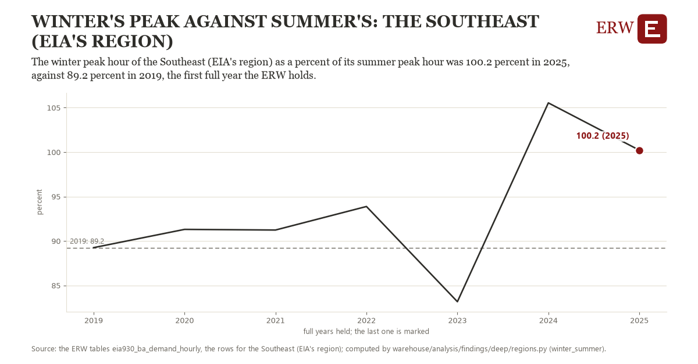

# Winter's peak against summer's: the Southeast (EIA's region)

Draft `scan-deep-52399852db2c` of the findings hunt over the whole warehouse (chain 502), 2026-11-19. State: draft, not reviewed. Review at `/internal/findings`.

**The finding.** The winter peak hour of the Southeast (EIA's region) as a percent of its summer peak hour was 100.2 percent in 2025, against 89.2 percent in 2019, the first full year the ERW holds.

**The figure by full year** (percent): 2019: 89.2, 2020: 91.3, 2021: 91.2, 2022: 93.9, 2023: 83.2, 2024: 105.5, 2025: 100.2.

**The tables and rows.** `eia930_ba_demand_hourly`; the rows for the Southeast (EIA's region), region key `rd_se` (the card's `hunt.region`), years 2019 to 2025. The yearly values: `winter-summer-rd-se.csv`.

**Its strength.** The change is 1.86 typical yearly moves (a typical move is 5.9 percent, 1.4826 times the median absolute change between full years). Holds in more than one year: 5 of the 6 full years after 2019 lie above 2019's value. Survives a change of window: from 2020 to 2025 the change is 8.9, from 2019 to 2024 it is 16.3. Sample large enough: 2019 holds 8,759 and 2025 holds 8,760 observations; the floor is 8,000. Half the change remains without the first year: from 2020 to 2025 the change is 8.9, 81.3 percent of the change from 2019. At least one typical yearly move: the change is 1.86 typical yearly moves (5.9 percent a year, the median move between full years); the floor is 1.

**Its limits.** EIA-930 as the balancing authorities report it; a region's demand is the sum of its authorities that file demand, an hour held only when all of them do; not adjusted for weather. A year's winter is its own January, February and December.

**Reproduce.** `python winter-summer-rd-se.reproduce.py <the table's CSV>` and `do winter-summer-rd-se.reproduce.do` (Stata) recompute the figures by year from the tables as the public downloads hold them; each names the expected values at its top.
