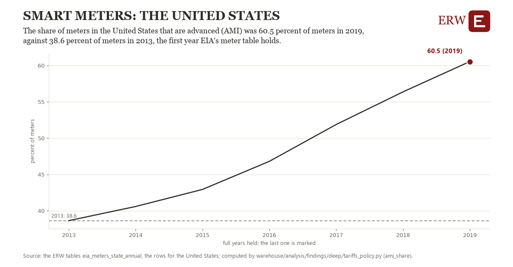

# Smart meters: the United States

Draft `scan-deep-bd4ddaf8e303` of the findings hunt over the whole warehouse (chain 164), 2026-11-06. State: draft, not reviewed. Review at `/internal/findings`.

**The finding.** The share of meters in the United States that are advanced (AMI) was 60.5 percent of meters in 2019, against 38.6 percent of meters in 2013, the first year EIA's meter table holds.

**The figure by full year** (percent of meters): 2013: 38.6, 2014: 40.6, 2015: 42.9, 2016: 46.8, 2017: 51.9, 2018: 56.4, 2019: 60.5.

**The tables and rows.** `eia_meters_state_annual`; the rows for the United States, region key `ami_US` (the card's `hunt.region`), years 2013 to 2019. The yearly values: `ami-share-ami-us.csv`.

**Its strength.** The change is 3.67 typical yearly moves (a typical move is 6.0 percent of meters, 1.4826 times the median absolute change between full years). Holds in more than one year: 6 of the 6 full years after 2013 lie above 2013's value. Survives a change of window: from 2014 to 2019 the change is 20.0, from 2013 to 2018 it is 17.7. Sample large enough: 2013 holds 1 and 2019 holds 1 observations; the floor is 1. Half the change remains without the first year: from 2014 to 2019 the change is 20.0, 91.1 percent of the change from 2013. At least one typical yearly move: the change is 3.67 typical yearly moves (6.0 percent of meters a year, the median move between full years); the floor is 1.

**Its limits.** EIA's figures as published, nominal dollars where a price; the latest months are preliminary. EIA-861's meter counts by type, as utilities report them; the ERW's table splits out advanced meters by state only to 2019.

**Reproduce.** `python ami-share-ami-us.reproduce.py <the table's CSV>` and `do ami-share-ami-us.reproduce.do` (Stata) recompute the figures by year from the tables as the public downloads hold them; each names the expected values at its top.
