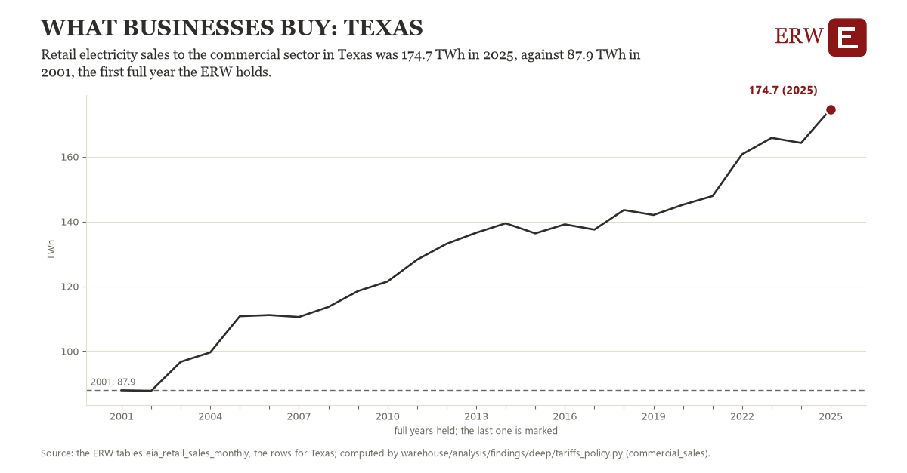

# What businesses buy: Texas

Draft `scan-deep-cea999e8b1d3` of the findings hunt over the whole warehouse (chain 164), 2026-11-06. State: draft, not reviewed. Review at `/internal/findings`.

**The finding.** Retail electricity sales to the commercial sector in Texas was 174.7 TWh in 2025, against 87.9 TWh in 2001, the first full year the ERW holds.

**The figure by full year** (TWh): 2001: 87.9, 2002: 87.7, 2003: 96.7, 2004: 99.6, 2005: 110.8, 2006: 111.1, 2007: 110.5, 2008: 113.6, 2009: 118.5, 2010: 121.5, 2011: 128.2, 2012: 133.1, 2013: 136.5, 2014: 139.4, 2015: 136.3, 2016: 139.1, 2017: 137.5, 2018: 143.5, 2019: 142.0, 2020: 145.2, 2021: 147.8, 2022: 160.7, 2023: 165.8, 2024: 164.2, 2025: 174.7.

**The tables and rows.** `eia_retail_sales_monthly`; the rows for Texas, region key `com_sales_TX` (the card's `hunt.region`), years 2001 to 2025. The yearly values: `commercial-sales-com-sales-tx.csv`.

**Its strength.** The change is 18.86 typical yearly moves (a typical move is 4.6 TWh, 1.4826 times the median absolute change between full years). Holds in more than one year: 23 of the 24 full years after 2001 lie above 2001's value. Survives a change of window: from 2002 to 2025 the change is 86.9, from 2001 to 2024 it is 76.3. Sample large enough: 2001 holds 12 and 2025 holds 12 observations; the floor is 11. Half the change remains without the first year: from 2002 to 2025 the change is 86.9, 100.2 percent of the change from 2001. At least one typical yearly move: the change is 18.86 typical yearly moves (4.6 TWh a year, the median move between full years); the floor is 1.

**Its limits.** EIA's figures as published, nominal dollars where a price; the latest months are preliminary. EIA's commercial sector holds offices, shops and most data centers that buy at retail, and a utility may class a large load as industrial instead.

**Reproduce.** `python commercial-sales-com-sales-tx.reproduce.py <the table's CSV>` and `do commercial-sales-com-sales-tx.reproduce.do` (Stata) recompute the figures by year from the tables as the public downloads hold them; each names the expected values at its top.
