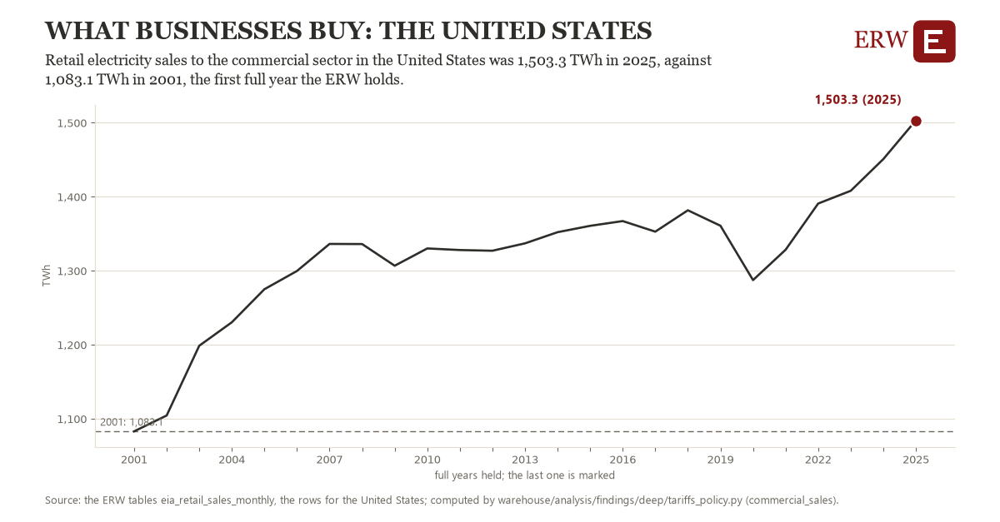

# What businesses buy: the United States

Draft `scan-deep-2f409a77aca6` of the findings hunt over the whole warehouse (chain 164), 2026-11-06. State: draft, not reviewed. Review at `/internal/findings`.

**The finding.** Retail electricity sales to the commercial sector in the United States was 1,503.3 TWh in 2025, against 1,083.1 TWh in 2001, the first full year the ERW holds.

**The figure by full year** (TWh): 2001: 1,083.1, 2002: 1,104.5, 2003: 1,198.7, 2004: 1,230.4, 2005: 1,275.1, 2006: 1,299.7, 2007: 1,336.3, 2008: 1,336.1, 2009: 1,306.9, 2010: 1,330.2, 2011: 1,328.1, 2012: 1,327.1, 2013: 1,337.1, 2014: 1,352.2, 2015: 1,360.8, 2016: 1,367.2, 2017: 1,352.9, 2018: 1,381.8, 2019: 1,360.9, 2020: 1,287.4, 2021: 1,328.4, 2022: 1,390.9, 2023: 1,408.1, 2024: 1,450.9, 2025: 1,503.3.

**The tables and rows.** `eia_retail_sales_monthly`; the rows for the United States, region key `com_sales_US` (the card's `hunt.region`), years 2001 to 2025. The yearly values: `commercial-sales-com-sales-us.csv`.

**Its strength.** The change is 11.81 typical yearly moves (a typical move is 35.6 TWh, 1.4826 times the median absolute change between full years). Holds in more than one year: 24 of the 24 full years after 2001 lie above 2001's value. Survives a change of window: from 2002 to 2025 the change is 398.8, from 2001 to 2024 it is 367.9. Sample large enough: 2001 holds 12 and 2025 holds 12 observations; the floor is 11. Half the change remains without the first year: from 2002 to 2025 the change is 398.8, 94.9 percent of the change from 2001. At least one typical yearly move: the change is 11.81 typical yearly moves (35.6 TWh a year, the median move between full years); the floor is 1.

**Its limits.** EIA's figures as published, nominal dollars where a price; the latest months are preliminary. EIA's commercial sector holds offices, shops and most data centers that buy at retail, and a utility may class a large load as industrial instead.

**Reproduce.** `python commercial-sales-com-sales-us.reproduce.py <the table's CSV>` and `do commercial-sales-com-sales-us.reproduce.do` (Stata) recompute the figures by year from the tables as the public downloads hold them; each names the expected values at its top.
