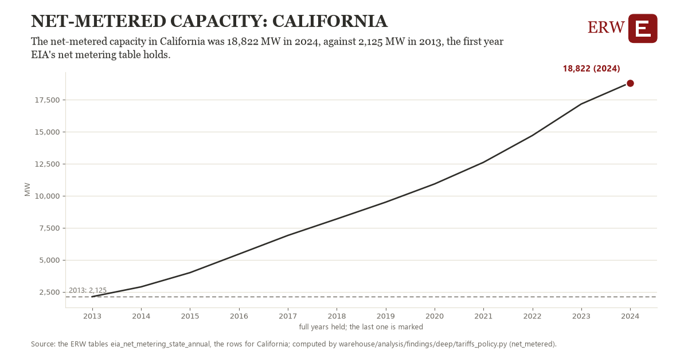

# Net-metered capacity: California

Draft `scan-deep-1902482e45f7` of the findings hunt over the whole warehouse (chain 164), 2026-11-06. State: draft, not reviewed. Review at `/internal/findings`.

**The finding.** The net-metered capacity in California was 18,822 MW in 2024, against 2,125 MW in 2013, the first year EIA's net metering table holds.

**The figure by full year** (MW): 2013: 2,125, 2014: 2,893, 2015: 4,001, 2016: 5,450, 2017: 6,905, 2018: 8,192, 2019: 9,501, 2020: 10,924, 2021: 12,611, 2022: 14,704, 2023: 17,164, 2024: 18,822.

**The tables and rows.** `eia_net_metering_state_annual`; the rows for California, region key `nem_CA` (the card's `hunt.region`), years 2013 to 2024. The yearly values: `net-metered-nem-ca.csv`.

**Its strength.** The change is 7.78 typical yearly moves (a typical move is 2,147 MW, 1.4826 times the median absolute change between full years). Holds in more than one year: 11 of the 11 full years after 2013 lie above 2013's value. Survives a change of window: from 2014 to 2024 the change is 15,929, from 2013 to 2023 it is 15,038. Sample large enough: 2013 holds 1 and 2024 holds 1 observations; the floor is 1. Half the change remains without the first year: from 2014 to 2024 the change is 15,929, 95.4 percent of the change from 2013. At least one typical yearly move: the change is 7.78 typical yearly moves (2,147 MW a year, the median move between full years); the floor is 1.

**Its limits.** EIA's figures as published, nominal dollars where a price; the latest months are preliminary. Net-metered systems as utilities report them to EIA-861; most is rooftop solar.

**Reproduce.** `python net-metered-nem-ca.reproduce.py <the table's CSV>` and `do net-metered-nem-ca.reproduce.do` (Stata) recompute the figures by year from the tables as the public downloads hold them; each names the expected values at its top.
