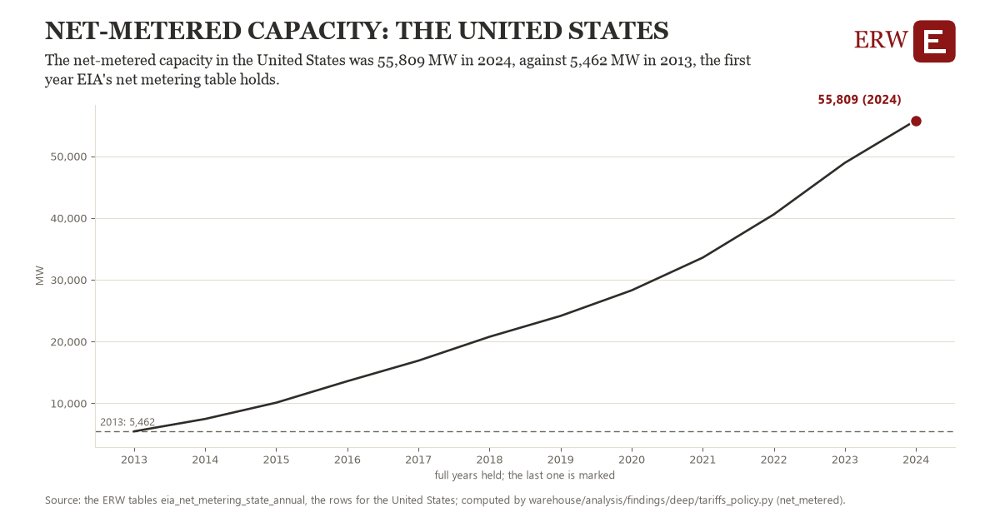

# Net-metered capacity: the United States

Draft `scan-deep-8b410b7a1fb4` of the findings hunt over the whole warehouse (chain 164), 2026-11-06. State: draft, not reviewed. Review at `/internal/findings`.

**The finding.** The net-metered capacity in the United States was 55,809 MW in 2024, against 5,462 MW in 2013, the first year EIA's net metering table holds.

**The figure by full year** (MW): 2013: 5,462, 2014: 7,471, 2015: 10,105, 2016: 13,582, 2017: 16,903, 2018: 20,772, 2019: 24,147, 2020: 28,283, 2021: 33,580, 2022: 40,575, 2023: 48,926, 2024: 55,809.

**The tables and rows.** `eia_net_metering_state_annual`; the rows for the United States, region key `nem_US` (the card's `hunt.region`), years 2013 to 2024. The yearly values: `net-metered-nem-us.csv`.

**Its strength.** The change is 8.78 typical yearly moves (a typical move is 5,735 MW, 1.4826 times the median absolute change between full years). Holds in more than one year: 11 of the 11 full years after 2013 lie above 2013's value. Survives a change of window: from 2014 to 2024 the change is 48,338, from 2013 to 2023 it is 43,464. Sample large enough: 2013 holds 1 and 2024 holds 1 observations; the floor is 1. Half the change remains without the first year: from 2014 to 2024 the change is 48,338, 96.0 percent of the change from 2013. At least one typical yearly move: the change is 8.78 typical yearly moves (5,735 MW a year, the median move between full years); the floor is 1.

**Its limits.** EIA's figures as published, nominal dollars where a price; the latest months are preliminary. Net-metered systems as utilities report them to EIA-861; most is rooftop solar.

**Reproduce.** `python net-metered-nem-us.reproduce.py <the table's CSV>` and `do net-metered-nem-us.reproduce.do` (Stata) recompute the figures by year from the tables as the public downloads hold them; each names the expected values at its top.
