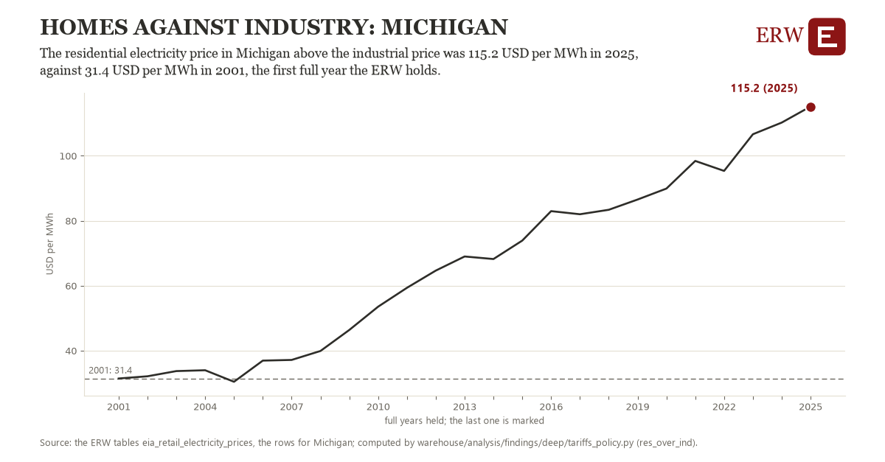

# Homes against industry: Michigan

Draft `scan-deep-25c23e4885ff` of the findings hunt over the whole warehouse (chain 164), 2026-11-06. State: draft, not reviewed. Review at `/internal/findings`.

**The finding.** The residential electricity price in Michigan above the industrial price was 115.2 USD per MWh in 2025, against 31.4 USD per MWh in 2001, the first full year the ERW holds.

**The figure by full year** (USD per MWh): 2001: 31.4, 2002: 32.1, 2003: 33.7, 2004: 34.0, 2005: 30.4, 2006: 36.9, 2007: 37.1, 2008: 39.9, 2009: 46.4, 2010: 53.5, 2011: 59.4, 2012: 64.7, 2013: 69.0, 2014: 68.2, 2015: 73.9, 2016: 83.0, 2017: 82.0, 2018: 83.4, 2019: 86.5, 2020: 89.9, 2021: 98.4, 2022: 95.4, 2023: 106.6, 2024: 110.2, 2025: 115.2.

**The tables and rows.** `eia_retail_electricity_prices`; the rows for Michigan, region key `res_ind_gap_MI` (the card's `hunt.region`), years 2001 to 2025. The yearly values: `res-over-ind-res-ind-gap-mi.csv`.

**Its strength.** The change is 15.82 typical yearly moves (a typical move is 5.3 USD per MWh, 1.4826 times the median absolute change between full years). Holds in more than one year: 23 of the 24 full years after 2001 lie above 2001's value. Survives a change of window: from 2002 to 2025 the change is 83.1, from 2001 to 2024 it is 78.8. Sample large enough: 2001 holds 12 and 2025 holds 12 observations; the floor is 11. Half the change remains without the first year: from 2002 to 2025 the change is 83.1, 99.2 percent of the change from 2001. At least one typical yearly move: the change is 15.82 typical yearly moves (5.3 USD per MWh a year, the median move between full years); the floor is 1.

**Its limits.** EIA's figures as published, nominal dollars where a price; the latest months are preliminary.

**Reproduce.** `python res-over-ind-res-ind-gap-mi.reproduce.py <the table's CSV>` and `do res-over-ind-res-ind-gap-mi.reproduce.do` (Stata) recompute the figures by year from the tables as the public downloads hold them; each names the expected values at its top.
