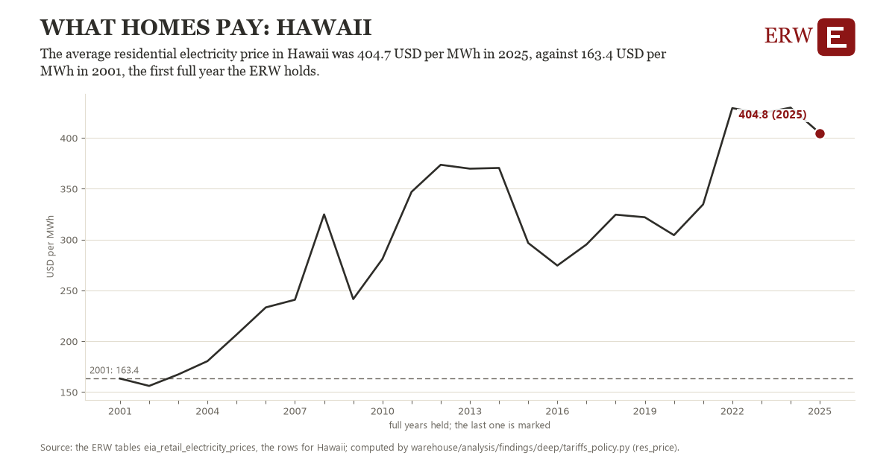

# What homes pay: Hawaii

Draft `scan-deep-3e07973c5f92` of the findings hunt over the whole warehouse (chain 164), 2026-11-06. State: draft, not reviewed. Review at `/internal/findings`.

**The finding.** The average residential electricity price in Hawaii was 404.7 USD per MWh in 2025, against 163.4 USD per MWh in 2001, the first full year the ERW holds.

**The figure by full year** (USD per MWh): 2001: 163.4, 2002: 156.1, 2003: 167.4, 2004: 180.5, 2005: 206.6, 2006: 233.3, 2007: 240.9, 2008: 324.8, 2009: 241.5, 2010: 280.9, 2011: 347.0, 2012: 373.6, 2013: 369.8, 2014: 370.5, 2015: 296.7, 2016: 274.5, 2017: 295.3, 2018: 324.5, 2019: 322.0, 2020: 304.4, 2021: 334.7, 2022: 429.3, 2023: 424.4, 2024: 429.8, 2025: 404.7.

**The tables and rows.** `eia_retail_electricity_prices`; the rows for Hawaii, region key `res_price_HI` (the card's `hunt.region`), years 2001 to 2025. The yearly values: `res-price-res-price-hi.csv`.

**Its strength.** The change is 6.89 typical yearly moves (a typical move is 35.0 USD per MWh, 1.4826 times the median absolute change between full years). Holds in more than one year: 23 of the 24 full years after 2001 lie above 2001's value. Survives a change of window: from 2002 to 2025 the change is 248.6, from 2001 to 2024 it is 266.4. Sample large enough: 2001 holds 12 and 2025 holds 12 observations; the floor is 11. Half the change remains without the first year: from 2002 to 2025 the change is 248.6, 103.0 percent of the change from 2001. At least one typical yearly move: the change is 6.89 typical yearly moves (35.0 USD per MWh a year, the median move between full years); the floor is 1.

**Its limits.** EIA's figures as published, nominal dollars where a price; the latest months are preliminary. A mean of the months, not weighted by each month's sales.

**Reproduce.** `python res-price-res-price-hi.reproduce.py <the table's CSV>` and `do res-price-res-price-hi.reproduce.do` (Stata) recompute the figures by year from the tables as the public downloads hold them; each names the expected values at its top.
