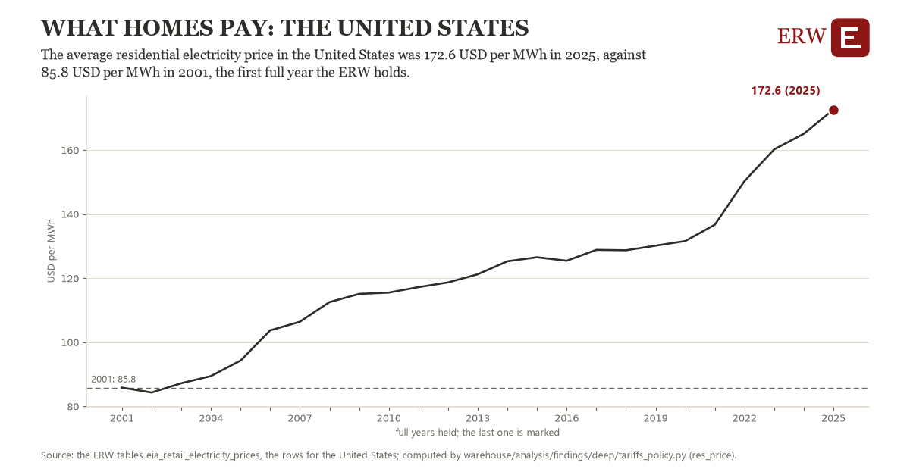

# What homes pay: the United States

Draft `scan-deep-3a7bd234ee53` of the findings hunt over the whole warehouse (chain 164), 2026-11-06. State: draft, not reviewed. Review at `/internal/findings`.

**The finding.** The average residential electricity price in the United States was 172.6 USD per MWh in 2025, against 85.8 USD per MWh in 2001, the first full year the ERW holds.

**The figure by full year** (USD per MWh): 2001: 85.8, 2002: 84.3, 2003: 87.2, 2004: 89.4, 2005: 94.3, 2006: 103.7, 2007: 106.4, 2008: 112.5, 2009: 115.1, 2010: 115.5, 2011: 117.2, 2012: 118.7, 2013: 121.2, 2014: 125.3, 2015: 126.5, 2016: 125.4, 2017: 128.8, 2018: 128.7, 2019: 130.1, 2020: 131.6, 2021: 136.7, 2022: 150.3, 2023: 160.2, 2024: 165.1, 2025: 172.6.

**The tables and rows.** `eia_retail_electricity_prices`; the rows for the United States, region key `res_price_US` (the card's `hunt.region`), years 2001 to 2025. The yearly values: `res-price-res-price-us.csv`.

**Its strength.** The change is 22.34 typical yearly moves (a typical move is 3.9 USD per MWh, 1.4826 times the median absolute change between full years). Holds in more than one year: 23 of the 24 full years after 2001 lie above 2001's value. Survives a change of window: from 2002 to 2025 the change is 88.3, from 2001 to 2024 it is 79.2. Sample large enough: 2001 holds 12 and 2025 holds 12 observations; the floor is 11. Half the change remains without the first year: from 2002 to 2025 the change is 88.3, 101.8 percent of the change from 2001. At least one typical yearly move: the change is 22.34 typical yearly moves (3.9 USD per MWh a year, the median move between full years); the floor is 1.

**Its limits.** EIA's figures as published, nominal dollars where a price; the latest months are preliminary. A mean of the months, not weighted by each month's sales.

**Reproduce.** `python res-price-res-price-us.reproduce.py <the table's CSV>` and `do res-price-res-price-us.reproduce.do` (Stata) recompute the figures by year from the tables as the public downloads hold them; each names the expected values at its top.
