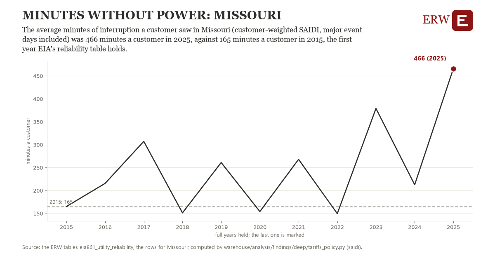

# Minutes without power: Missouri

Draft `scan-deep-4d2d647be64d` of the findings hunt over the whole warehouse (chain 164), 2026-11-06. State: draft, not reviewed. Review at `/internal/findings`.

**The finding.** The average minutes of interruption a customer saw in Missouri (customer-weighted SAIDI, major event days included) was 466 minutes a customer in 2025, against 165 minutes a customer in 2015, the first year EIA's reliability table holds.

**The figure by full year** (minutes a customer): 2015: 165, 2016: 215, 2017: 307, 2018: 151, 2019: 261, 2020: 154, 2021: 268, 2022: 150, 2023: 379, 2024: 213, 2025: 466.

**The tables and rows.** `eia861_utility_reliability`; the rows for Missouri, region key `saidi_MO` (the card's `hunt.region`), years 2015 to 2025. The yearly values: `saidi-saidi-mo.csv`.

**Its strength.** The change is 1.75 typical yearly moves (a typical move is 172 minutes a customer, 1.4826 times the median absolute change between full years). Holds in more than one year: 7 of the 10 full years after 2015 lie above 2015's value. Survives a change of window: from 2016 to 2025 the change is 251, from 2015 to 2024 it is 48. Sample large enough: 2015 holds 1 and 2025 holds 1 observations; the floor is 1. Half the change remains without the first year: from 2016 to 2025 the change is 251, 83.2 percent of the change from 2015. At least one typical yearly move: the change is 1.75 typical yearly moves (172 minutes a customer a year, the median move between full years); the floor is 1.

**Its limits.** EIA-861's utility reports; the utilities that report SAIDI change from year to year, and major storms dominate a year's figure.

**Reproduce.** `python saidi-saidi-mo.reproduce.py <the table's CSV>` and `do saidi-saidi-mo.reproduce.do` (Stata) recompute the figures by year from the tables as the public downloads hold them; each names the expected values at its top.
