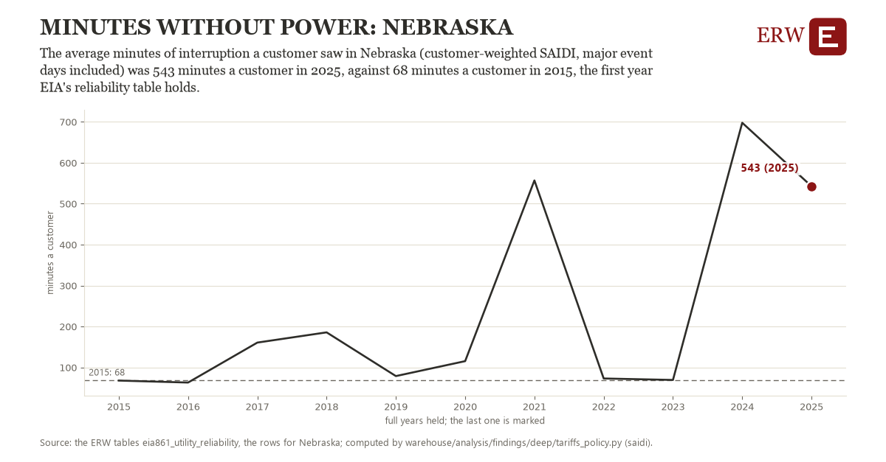

# Minutes without power: Nebraska

Draft `scan-deep-1483006a7d41` of the findings hunt over the whole warehouse (chain 164), 2026-11-06. State: draft, not reviewed. Review at `/internal/findings`.

**The finding.** The average minutes of interruption a customer saw in Nebraska (customer-weighted SAIDI, major event days included) was 543 minutes a customer in 2025, against 68 minutes a customer in 2015, the first year EIA's reliability table holds.

**The figure by full year** (minutes a customer): 2015: 68, 2016: 63, 2017: 161, 2018: 186, 2019: 79, 2020: 115, 2021: 557, 2022: 73, 2023: 69, 2024: 698, 2025: 543.

**The tables and rows.** `eia861_utility_reliability`; the rows for Nebraska, region key `saidi_NE` (the card's `hunt.region`), years 2015 to 2025. The yearly values: `saidi-saidi-ne.csv`.

**Its strength.** The change is 3.13 typical yearly moves (a typical move is 152 minutes a customer, 1.4826 times the median absolute change between full years). Holds in more than one year: 9 of the 10 full years after 2015 lie above 2015's value. Survives a change of window: from 2016 to 2025 the change is 480, from 2015 to 2024 it is 630. Sample large enough: 2015 holds 1 and 2025 holds 1 observations; the floor is 1. Half the change remains without the first year: from 2016 to 2025 the change is 480, 101.0 percent of the change from 2015. At least one typical yearly move: the change is 3.13 typical yearly moves (152 minutes a customer a year, the median move between full years); the floor is 1.

**Its limits.** EIA-861's utility reports; the utilities that report SAIDI change from year to year, and major storms dominate a year's figure.

**Reproduce.** `python saidi-saidi-ne.reproduce.py <the table's CSV>` and `do saidi-saidi-ne.reproduce.do` (Stata) recompute the figures by year from the tables as the public downloads hold them; each names the expected values at its top.
