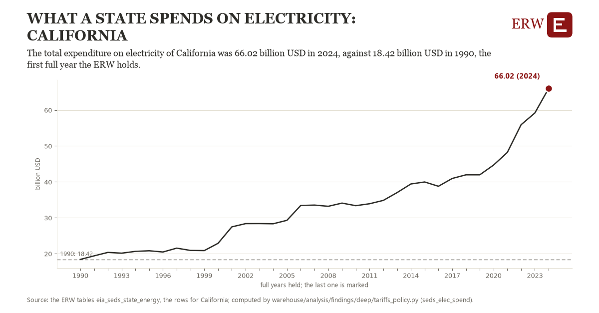

# What a state spends on electricity: California

Draft `scan-deep-e1e93340babe` of the findings hunt over the whole warehouse (chain 502), 2026-11-19. State: draft, not reviewed. Review at `/internal/findings`.

**The finding.** The total expenditure on electricity of California was 66.02 billion USD in 2024, against 18.42 billion USD in 1990, the first full year the ERW holds.

**The figure by full year** (billion USD): 1990: 18.42, 1991: 19.41, 1992: 20.37, 1993: 20.16, 1994: 20.66, 1995: 20.82, 1996: 20.48, 1997: 21.56, 1998: 20.92, 1999: 20.87, 2000: 22.90, 2001: 27.48, 2002: 28.38, 2003: 28.39, 2004: 28.34, 2005: 29.30, 2006: 33.43, 2007: 33.55, 2008: 33.21, 2009: 34.10, 2010: 33.38, 2011: 33.92, 2012: 34.85, 2013: 37.03, 2014: 39.42, 2015: 39.98, 2016: 38.79, 2017: 40.96, 2018: 41.97, 2019: 41.97, 2020: 44.68, 2021: 48.20, 2022: 55.92, 2023: 59.19, 2024: 66.02.

**The tables and rows.** `eia_seds_state_energy`; the rows for California, region key `sd_ca` (the card's `hunt.region`), years 1990 to 2024. The yearly values: `seds-elec-spend-sd-ca.csv`.

**Its strength.** The change is 33.87 typical yearly moves (a typical move is 1.41 billion USD, 1.4826 times the median absolute change between full years). Holds in more than one year: 34 of the 34 full years after 1990 lie above 1990's value. Survives a change of window: from 1991 to 2024 the change is 46.61, from 1990 to 2023 it is 40.77. Sample large enough: 1990 holds 1 and 2024 holds 1 observations; the floor is 1. Half the change remains without the first year: from 1991 to 2024 the change is 46.61, 97.9 percent of the change from 1990. At least one typical yearly move: the change is 33.87 typical yearly moves (1.41 billion USD a year, the median move between full years); the floor is 1.

**Its limits.** EIA's State Energy Data System, the latest release; the newest year is revised with each release; a state's consumption, wherever the energy was produced. Nominal dollars.

**Reproduce.** `python seds-elec-spend-sd-ca.reproduce.py <the table's CSV>` and `do seds-elec-spend-sd-ca.reproduce.do` (Stata) recompute the figures by year from the tables as the public downloads hold them; each names the expected values at its top.
