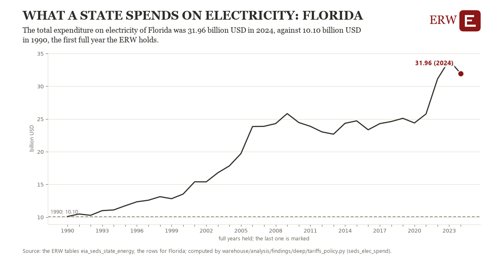

# What a state spends on electricity: Florida

Draft `scan-deep-5cc5f28ebc3c` of the findings hunt over the whole warehouse (chain 502), 2026-11-19. State: draft, not reviewed. Review at `/internal/findings`.

**The finding.** The total expenditure on electricity of Florida was 31.96 billion USD in 2024, against 10.10 billion USD in 1990, the first full year the ERW holds.

**The figure by full year** (billion USD): 1990: 10.10, 1991: 10.48, 1992: 10.28, 1993: 10.99, 1994: 11.10, 1995: 11.74, 1996: 12.34, 1997: 12.59, 1998: 13.13, 1999: 12.82, 2000: 13.53, 2001: 15.40, 2002: 15.39, 2003: 16.77, 2004: 17.83, 2005: 19.71, 2006: 23.84, 2007: 23.88, 2008: 24.30, 2009: 25.82, 2010: 24.46, 2011: 23.88, 2012: 23.03, 2013: 22.68, 2014: 24.34, 2015: 24.72, 2016: 23.35, 2017: 24.29, 2018: 24.61, 2019: 25.10, 2020: 24.39, 2021: 25.76, 2022: 31.13, 2023: 33.95, 2024: 31.96.

**The tables and rows.** `eia_seds_state_energy`; the rows for Florida, region key `sd_fl` (the card's `hunt.region`), years 1990 to 2024. The yearly values: `seds-elec-spend-sd-fl.csv`.

**Its strength.** The change is 20.83 typical yearly moves (a typical move is 1.05 billion USD, 1.4826 times the median absolute change between full years). Holds in more than one year: 34 of the 34 full years after 1990 lie above 1990's value. Survives a change of window: from 1991 to 2024 the change is 21.48, from 1990 to 2023 it is 23.86. Sample large enough: 1990 holds 1 and 2024 holds 1 observations; the floor is 1. Half the change remains without the first year: from 1991 to 2024 the change is 21.48, 98.3 percent of the change from 1990. At least one typical yearly move: the change is 20.83 typical yearly moves (1.05 billion USD a year, the median move between full years); the floor is 1.

**Its limits.** EIA's State Energy Data System, the latest release; the newest year is revised with each release; a state's consumption, wherever the energy was produced. Nominal dollars.

**Reproduce.** `python seds-elec-spend-sd-fl.reproduce.py <the table's CSV>` and `do seds-elec-spend-sd-fl.reproduce.do` (Stata) recompute the figures by year from the tables as the public downloads hold them; each names the expected values at its top.
