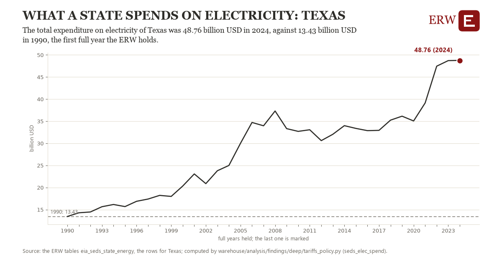

# What a state spends on electricity: Texas

Draft `scan-deep-2826d961bd4f` of the findings hunt over the whole warehouse (chain 502), 2026-11-19. State: draft, not reviewed. Review at `/internal/findings`.

**The finding.** The total expenditure on electricity of Texas was 48.76 billion USD in 2024, against 13.43 billion USD in 1990, the first full year the ERW holds.

**The figure by full year** (billion USD): 1990: 13.43, 1991: 14.27, 1992: 14.46, 1993: 15.64, 1994: 16.15, 1995: 15.68, 1996: 16.87, 1997: 17.39, 1998: 18.21, 1999: 17.98, 2000: 20.33, 2001: 23.06, 2002: 20.87, 2003: 23.79, 2004: 24.99, 2005: 29.99, 2006: 34.72, 2007: 33.96, 2008: 37.31, 2009: 33.32, 2010: 32.70, 2011: 33.06, 2012: 30.60, 2013: 32.03, 2014: 33.99, 2015: 33.37, 2016: 32.86, 2017: 32.93, 2018: 35.24, 2019: 36.14, 2020: 35.06, 2021: 39.13, 2022: 47.45, 2023: 48.72, 2024: 48.76.

**The tables and rows.** `eia_seds_state_energy`; the rows for Texas, region key `sd_tx` (the card's `hunt.region`), years 1990 to 2024. The yearly values: `seds-elec-spend-sd-tx.csv`.

**Its strength.** The change is 20.00 typical yearly moves (a typical move is 1.77 billion USD, 1.4826 times the median absolute change between full years). Holds in more than one year: 34 of the 34 full years after 1990 lie above 1990's value. Survives a change of window: from 1991 to 2024 the change is 34.49, from 1990 to 2023 it is 35.28. Sample large enough: 1990 holds 1 and 2024 holds 1 observations; the floor is 1. Half the change remains without the first year: from 1991 to 2024 the change is 34.49, 97.6 percent of the change from 1990. At least one typical yearly move: the change is 20.00 typical yearly moves (1.77 billion USD a year, the median move between full years); the floor is 1.

**Its limits.** EIA's State Energy Data System, the latest release; the newest year is revised with each release; a state's consumption, wherever the energy was produced. Nominal dollars.

**Reproduce.** `python seds-elec-spend-sd-tx.reproduce.py <the table's CSV>` and `do seds-elec-spend-sd-tx.reproduce.do` (Stata) recompute the figures by year from the tables as the public downloads hold them; each names the expected values at its top.
