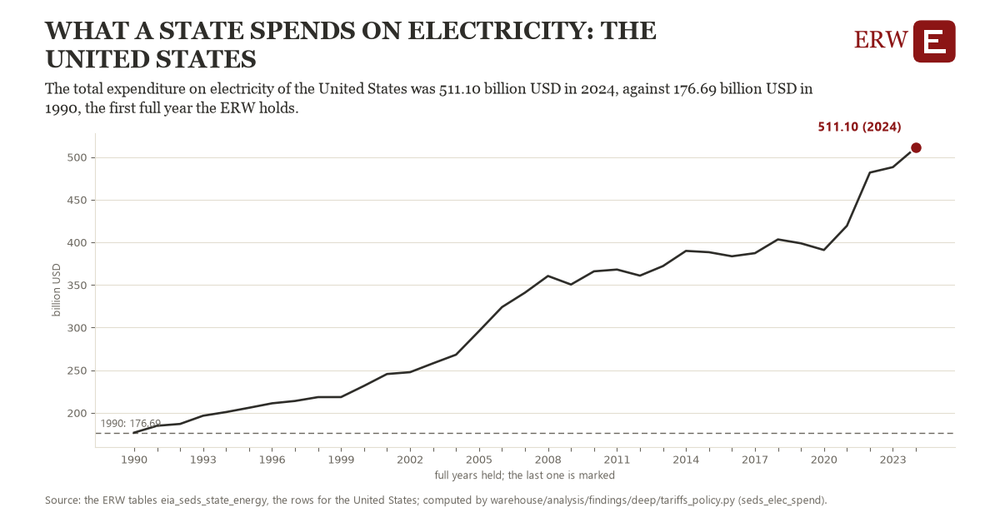

# What a state spends on electricity: the United States

Draft `scan-deep-523858d61b24` of the findings hunt over the whole warehouse (chain 502), 2026-11-19. State: draft, not reviewed. Review at `/internal/findings`.

**The finding.** The total expenditure on electricity of the United States was 511.10 billion USD in 2024, against 176.69 billion USD in 1990, the first full year the ERW holds.

**The figure by full year** (billion USD): 1990: 176.69, 1991: 184.77, 1992: 186.91, 1993: 196.53, 1994: 200.83, 1995: 205.88, 1996: 211.11, 1997: 213.84, 1998: 218.36, 1999: 218.41, 2000: 231.58, 2001: 245.48, 2002: 247.60, 2003: 257.99, 2004: 268.13, 2005: 295.79, 2006: 323.96, 2007: 340.92, 2008: 360.45, 2009: 350.44, 2010: 365.91, 2011: 368.01, 2012: 360.86, 2013: 372.07, 2014: 389.87, 2015: 388.34, 2016: 383.57, 2017: 387.22, 2018: 403.35, 2019: 398.77, 2020: 390.93, 2021: 419.30, 2022: 481.76, 2023: 488.12, 2024: 511.10.

**The tables and rows.** `eia_seds_state_energy`; the rows for the United States, region key `sd_us` (the card's `hunt.region`), years 1990 to 2024. The yearly values: `seds-elec-spend-sd-us.csv`.

**Its strength.** The change is 25.48 typical yearly moves (a typical move is 13.12 billion USD, 1.4826 times the median absolute change between full years). Holds in more than one year: 34 of the 34 full years after 1990 lie above 1990's value. Survives a change of window: from 1991 to 2024 the change is 326.33, from 1990 to 2023 it is 311.43. Sample large enough: 1990 holds 1 and 2024 holds 1 observations; the floor is 1. Half the change remains without the first year: from 1991 to 2024 the change is 326.33, 97.6 percent of the change from 1990. At least one typical yearly move: the change is 25.48 typical yearly moves (13.12 billion USD a year, the median move between full years); the floor is 1.

**Its limits.** EIA's State Energy Data System, the latest release; the newest year is revised with each release; a state's consumption, wherever the energy was produced. Nominal dollars.

**Reproduce.** `python seds-elec-spend-sd-us.reproduce.py <the table's CSV>` and `do seds-elec-spend-sd-us.reproduce.do` (Stata) recompute the figures by year from the tables as the public downloads hold them; each names the expected values at its top.
