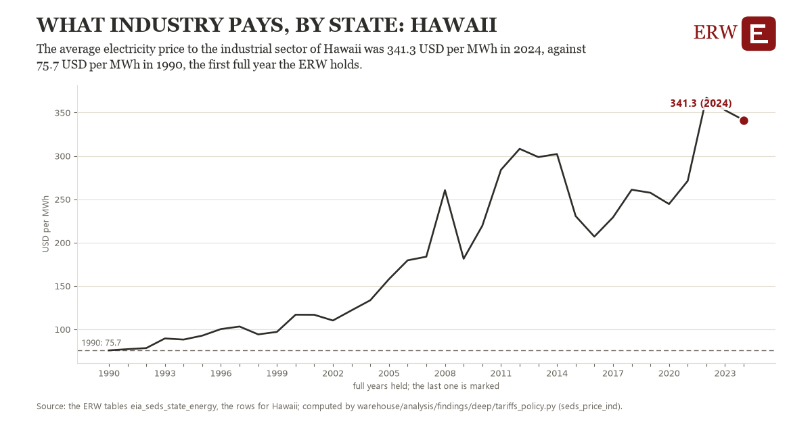

# What industry pays, by state: Hawaii

Draft `scan-deep-f2126b1a315f` of the findings hunt over the whole warehouse (chain 502), 2026-11-19. State: draft, not reviewed. Review at `/internal/findings`.

**The finding.** The average electricity price to the industrial sector of Hawaii was 341.3 USD per MWh in 2024, against 75.7 USD per MWh in 1990, the first full year the ERW holds.

**The figure by full year** (USD per MWh): 1990: 75.7, 1991: 77.1, 1992: 78.3, 1993: 89.5, 1994: 88.2, 1995: 92.7, 1996: 100.3, 1997: 103.2, 1998: 94.1, 1999: 97.0, 2000: 116.9, 2001: 116.8, 2002: 110.2, 2003: 121.9, 2004: 133.5, 2005: 157.9, 2006: 179.6, 2007: 183.8, 2008: 260.5, 2009: 181.4, 2010: 219.5, 2011: 284.0, 2012: 308.2, 2013: 298.7, 2014: 302.2, 2015: 230.6, 2016: 206.9, 2017: 229.2, 2018: 261.0, 2019: 257.5, 2020: 244.5, 2021: 271.2, 2022: 367.1, 2023: 352.8, 2024: 341.3.

**The tables and rows.** `eia_seds_state_energy`; the rows for Hawaii, region key `sd_hi` (the card's `hunt.region`), years 1990 to 2024. The yearly values: `seds-price-ind-sd-hi.csv`.

**Its strength.** The change is 15.35 typical yearly moves (a typical move is 17.3 USD per MWh, 1.4826 times the median absolute change between full years). Holds in more than one year: 34 of the 34 full years after 1990 lie above 1990's value. Survives a change of window: from 1991 to 2024 the change is 264.2, from 1990 to 2023 it is 277.1. Sample large enough: 1990 holds 1 and 2024 holds 1 observations; the floor is 1. Half the change remains without the first year: from 1991 to 2024 the change is 264.2, 99.5 percent of the change from 1990. At least one typical yearly move: the change is 15.35 typical yearly moves (17.3 USD per MWh a year, the median move between full years); the floor is 1.

**Its limits.** EIA's State Energy Data System, the latest release; the newest year is revised with each release; a state's consumption, wherever the energy was produced. Nominal dollars; SEDS's price is the sector's revenue over its sales in the state, USD per MMBtu times 3.412.

**Reproduce.** `python seds-price-ind-sd-hi.reproduce.py <the table's CSV>` and `do seds-price-ind-sd-hi.reproduce.do` (Stata) recompute the figures by year from the tables as the public downloads hold them; each names the expected values at its top.
