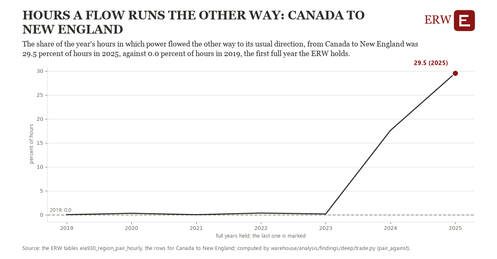

# Hours a flow runs the other way: Canada to New England

Draft `scan-deep-b094931bd30c` of the findings hunt over the whole warehouse (chain 502), 2026-11-19. State: draft, not reviewed. Review at `/internal/findings`.

**The finding.** The share of the year's hours in which power flowed the other way to its usual direction, from Canada to New England was 29.5 percent of hours in 2025, against 0.0 percent of hours in 2019, the first full year the ERW holds.

**The figure by full year** (percent of hours): 2019: 0.0, 2020: 0.3, 2021: 0.0, 2022: 0.3, 2023: 0.1, 2024: 17.6, 2025: 29.5.

**The tables and rows.** `eia930_region_pair_hourly`; the rows for Canada to New England, region key `rp_can_ne` (the card's `hunt.region`), years 2019 to 2025. The yearly values: `pair-against-rp-can-ne.csv`.

**Its strength.** The change is 64.66 typical yearly moves (a typical move is 0.5 percent of hours, 1.4826 times the median absolute change between full years). Holds in more than one year: 5 of the 6 full years after 2019 lie above 2019's value. Survives a change of window: from 2020 to 2025 the change is 29.2, from 2019 to 2024 it is 17.6. Sample large enough: 2019 holds 8,760 and 2025 holds 8,760 observations; the floor is 8,000. Half the change remains without the first year: from 2020 to 2025 the change is 29.2, 99.0 percent of the change from 2019. At least one typical yearly move: the change is 64.66 typical yearly moves (0.5 percent of hours a year, the median move between full years); the floor is 1.

**Its limits.** EIA-930 as the balancing authorities report it, each region's figure summed from its authorities' reports; the ties between two regions can change over the years; an hour at exactly zero counts as neither way.

**Reproduce.** `python pair-against-rp-can-ne.reproduce.py <the table's CSV>` and `do pair-against-rp-can-ne.reproduce.do` (Stata) recompute the figures by year from the tables as the public downloads hold them; each names the expected values at its top.
