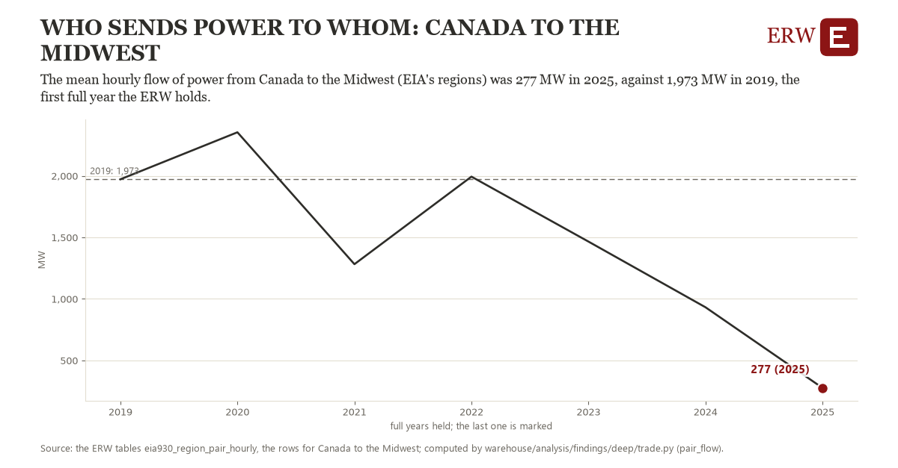

# Who sends power to whom: Canada to the Midwest

Draft `scan-deep-c4352975cec0` of the findings hunt over the whole warehouse (chain 502), 2026-11-19. State: draft, not reviewed. Review at `/internal/findings`.

**The finding.** The mean hourly flow of power from Canada to the Midwest (EIA's regions) was 277 MW in 2025, against 1,973 MW in 2019, the first full year the ERW holds.

**The figure by full year** (MW): 2019: 1,973, 2020: 2,354, 2021: 1,282, 2022: 1,994, 2023: 1,466, 2024: 932, 2025: 277.

**The tables and rows.** `eia930_region_pair_hourly`; the rows for Canada to the Midwest, region key `rp_can_midw` (the card's `hunt.region`), years 2019 to 2025. The yearly values: `pair-flow-rp-can-midw.csv`.

**Its strength.** The change is 1.92 typical yearly moves (a typical move is 881 MW, 1.4826 times the median absolute change between full years). Holds in more than one year: 4 of the 6 full years after 2019 lie below 2019's value. Survives a change of window: from 2020 to 2025 the change is -2,077, from 2019 to 2024 it is -1,040. Sample large enough: 2019 holds 8,759 and 2025 holds 8,760 observations; the floor is 8,000. Half the change remains without the first year: from 2020 to 2025 the change is -2,077, 122.5 percent of the change from 2019. At least one typical yearly move: the change is 1.92 typical yearly moves (881 MW a year, the median move between full years); the floor is 1.

**Its limits.** EIA-930 as the balancing authorities report it, each region's figure summed from its authorities' reports; the ties between two regions can change over the years; a mean of the hours held, not a metered annual total. A negative mean is a year power flowed the other way on balance.

**Reproduce.** `python pair-flow-rp-can-midw.reproduce.py <the table's CSV>` and `do pair-flow-rp-can-midw.reproduce.do` (Stata) recompute the figures by year from the tables as the public downloads hold them; each names the expected values at its top.
