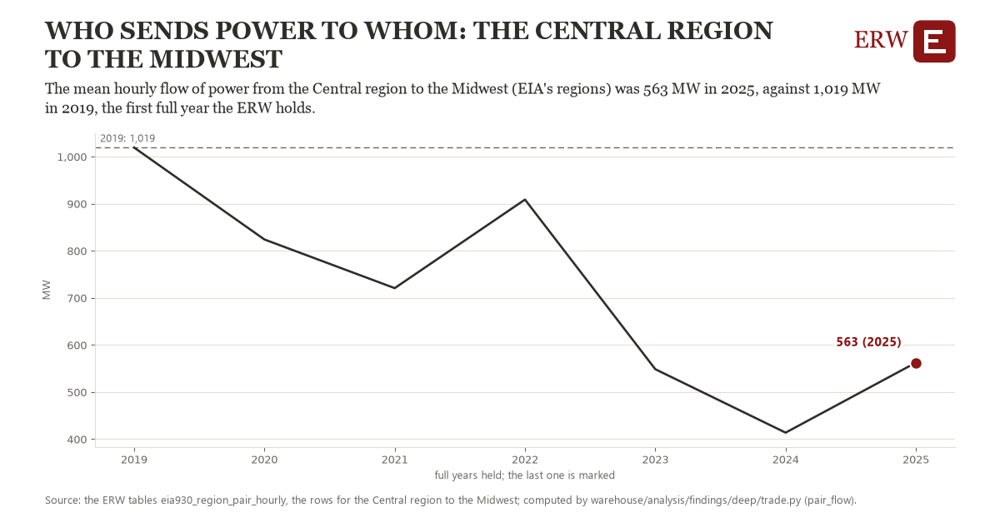

# Who sends power to whom: the Central region to the Midwest

Draft `scan-deep-fcd27f711944` of the findings hunt over the whole warehouse (chain 502), 2026-11-19. State: draft, not reviewed. Review at `/internal/findings`.

**The finding.** The mean hourly flow of power from the Central region to the Midwest (EIA's regions) was 563 MW in 2025, against 1,019 MW in 2019, the first full year the ERW holds.

**The figure by full year** (MW): 2019: 1,019, 2020: 824, 2021: 721, 2022: 909, 2023: 549, 2024: 414, 2025: 563.

**The tables and rows.** `eia930_region_pair_hourly`; the rows for the Central region to the Midwest, region key `rp_cent_midw` (the card's `hunt.region`), years 2019 to 2025. The yearly values: `pair-flow-rp-cent-midw.csv`.

**Its strength.** The change is 1.83 typical yearly moves (a typical move is 250 MW, 1.4826 times the median absolute change between full years). Holds in more than one year: 6 of the 6 full years after 2019 lie below 2019's value. Survives a change of window: from 2020 to 2025 the change is -262, from 2019 to 2024 it is -606. Sample large enough: 2019 holds 8,754 and 2025 holds 8,712 observations; the floor is 8,000. Half the change remains without the first year: from 2020 to 2025 the change is -262, 57.3 percent of the change from 2019. At least one typical yearly move: the change is 1.83 typical yearly moves (250 MW a year, the median move between full years); the floor is 1.

**Its limits.** EIA-930 as the balancing authorities report it, each region's figure summed from its authorities' reports; the ties between two regions can change over the years; a mean of the hours held, not a metered annual total. A negative mean is a year power flowed the other way on balance.

**Reproduce.** `python pair-flow-rp-cent-midw.reproduce.py <the table's CSV>` and `do pair-flow-rp-cent-midw.reproduce.do` (Stata) recompute the figures by year from the tables as the public downloads hold them; each names the expected values at its top.
