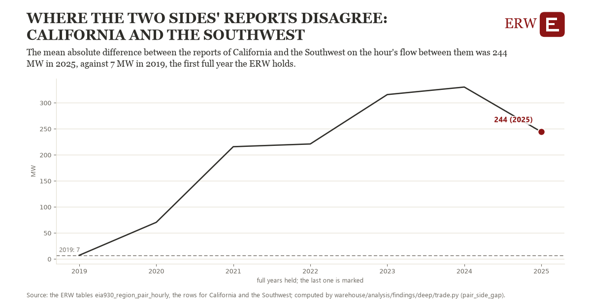

# Where the two sides' reports disagree: California and the Southwest

Draft `scan-deep-ebca4792f7b0` of the findings hunt over the whole warehouse (chain 502), 2026-11-19. State: draft, not reviewed. Review at `/internal/findings`.

**The finding.** The mean absolute difference between the reports of California and the Southwest on the hour's flow between them was 244 MW in 2025, against 7 MW in 2019, the first full year the ERW holds.

**The figure by full year** (MW): 2019: 7, 2020: 70, 2021: 216, 2022: 221, 2023: 316, 2024: 330, 2025: 244.

**The tables and rows.** `eia930_region_pair_hourly`; the rows for California and the Southwest, region key `rg_cal_sw` (the card's `hunt.region`), years 2019 to 2025. The yearly values: `pair-side-gap-rg-cal-sw.csv`.

**Its strength.** The change is 2.14 typical yearly moves (a typical move is 111 MW, 1.4826 times the median absolute change between full years). Holds in more than one year: 6 of the 6 full years after 2019 lie above 2019's value. Survives a change of window: from 2020 to 2025 the change is 174, from 2019 to 2024 it is 323. Sample large enough: 2019 holds 8,538 and 2025 holds 8,601 observations; the floor is 8,000. Half the change remains without the first year: from 2020 to 2025 the change is 174, 73.3 percent of the change from 2019. At least one typical yearly move: the change is 2.14 typical yearly moves (111 MW a year, the median move between full years); the floor is 1.

**Its limits.** Each side summed from its balancing authorities' reports on the ties between the two regions, hours both sides hold; which side is right is not known from these rows.

**Reproduce.** `python pair-side-gap-rg-cal-sw.reproduce.py <the table's CSV>` and `do pair-side-gap-rg-cal-sw.reproduce.do` (Stata) recompute the figures by year from the tables as the public downloads hold them; each names the expected values at its top.
