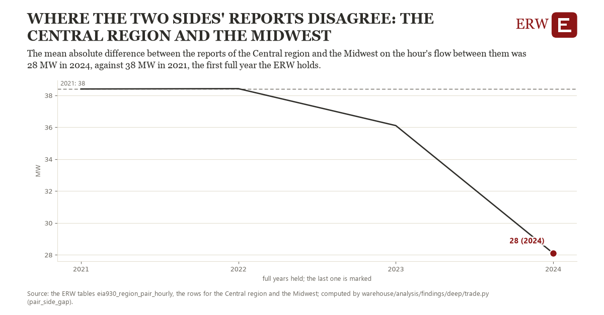

# Where the two sides' reports disagree: the Central region and the Midwest

Draft `scan-deep-64eac9daa401` of the findings hunt over the whole warehouse (chain 502), 2026-11-19. State: draft, not reviewed. Review at `/internal/findings`.

**The finding.** The mean absolute difference between the reports of the Central region and the Midwest on the hour's flow between them was 28 MW in 2024, against 38 MW in 2021, the first full year the ERW holds.

**The figure by full year** (MW): 2021: 38, 2022: 38, 2023: 36, 2024: 28.

**The tables and rows.** `eia930_region_pair_hourly`; the rows for the Central region and the Midwest, region key `rg_cent_midw` (the card's `hunt.region`), years 2021 to 2024. The yearly values: `pair-side-gap-rg-cent-midw.csv`.

**Its strength.** The change is 3.00 typical yearly moves (a typical move is 3 MW, 1.4826 times the median absolute change between full years). Holds in more than one year: 2 of the 3 full years after 2021 lie below 2021's value. Survives a change of window: from 2022 to 2024 the change is -10, from 2021 to 2023 it is -2. Sample large enough: 2021 holds 8,219 and 2024 holds 8,396 observations; the floor is 8,000. Half the change remains without the first year: from 2022 to 2024 the change is -10, 100.2 percent of the change from 2021. At least one typical yearly move: the change is 3.00 typical yearly moves (3 MW a year, the median move between full years); the floor is 1.

**Its limits.** Each side summed from its balancing authorities' reports on the ties between the two regions, hours both sides hold; which side is right is not known from these rows.

**Reproduce.** `python pair-side-gap-rg-cent-midw.reproduce.py <the table's CSV>` and `do pair-side-gap-rg-cent-midw.reproduce.do` (Stata) recompute the figures by year from the tables as the public downloads hold them; each names the expected values at its top.
